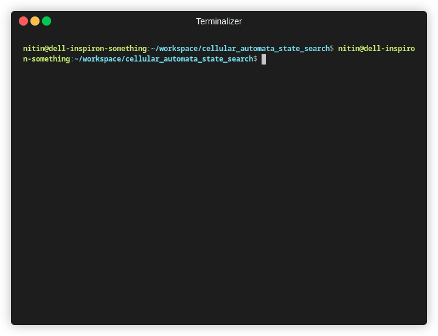

## CAS3 - Cellular Automata State Space Search for Prime Generation

Prime numbers are intriguing, they compose all other numbers. Cellular automata is a computational paradigm which has a simple set of rules, works in an N-dimensional grid with a start state, and rules being applied iteratively to every cell in parallel. The rules have input as a cell's immediate neighbours, and output as a state of the cell. For simplicity, the state can be thought of as ON or OFF.

This project attempts to figure out if there is an N-dimensional cellular automata which will generate the prime number sequence. The resulting cell-cluster would combine to form all other numbers in our universe!  

This project is not computationaly feasible, and is hence a learning project. Contributions are welcome, if you think you can make it do the search faster, do ping me or send in a PR.

I found it generating rules for sequence such as :
<br/>1,2,3,4..
<br/>1,3,5,7..
<br/>1,4,9,16,25,36..
<br/>The most interesting I've found has been 1, 3, 5, 9, 11, 15, 19, 27



### Space
Start with one cell, apply rules. If successful, the applied rules would produce blocks of cells which are set, and the number of cells in such a block would be prime numbers :D

### Cell
N-dimensional vector (Co-ordinates) + Value. Value is either Set or Unset

### Rule

One rule specifies which neighbours to check, what check to be done and what rule should be applied.

Which neighbours to check -  This is defined by the "elements" vector, where each element has 3 values: SameCoordinate, Positive, Negative
As expected of the naming, when this rule is checked against a cell, it'll check it's neighbours, changing ith coordinate accordingly (SameCoordinate - no change, Positive - +1, Negative - -1)

What check to be done – Is whether the specified neighbours are set or not set. Rule has ExpectedCellValue which checks if the neighbours are as expected

What rule should be applied – Is whether the corresponding cell should be set, unset or flipped in value. RuleResult does this.


### Dimensions

Number of dimensions of the universe is unknown. We need to generate for increasing numbers, starting at 3 (since we live in 3 dimensions)


State space search:
Stop the search if successive applications of rule is not producing the next prime number in sequence (1,2,3,5,7,11,13...)

### Search Space Pruning (legacy expression search)

Following techniques has been applied to reduce the search space of the original expression-tree enumeration (`legacy` command). The rule-table search below goes a lot further.

* We generating boolean expressions of N variables, would only generate half the tree. The other half is symmetric, and gets 
handled by the permutation we apply to input variables. So for three variables, we generate from `(A AND B AND C)` to `(A AND (B OR C))`, we won't generate `((A OR B) AND C)`
* Input variables are clustered if they share the same op next to each other. For ex. `(A AND (B AND C))` clusters `[A,B,C]`. `(A AND (B OR C))` clusters as `[[A],[B,C]]`. These are clustered as the variables can be changed with each other without affecting output for the expression, so no value in permuting on them.
* We generate permutation of input variables based on clusters. So we generate `[[B],[A,C]]`, `[[C],[B,A]]` but not `[[A],[C,B]]`.
* Since we generate all boolean expressions, for cases like `(A AND (NOT B OR C))`, even if we are not permuting (A, B), we will search for the rule `(A AND (B OR NOT C))` as well
* Not exploring rules with action "Unset", they are lame

## Reducing the search space: exact rule-table search

The expression enumeration walks a *syntactic* space: formulas and input permutations. The `space` command shows how fast it grows (before the input permutations tried for each structure):

| dimension | inputs (3^N) | expression structures per boolean function | (birth, survival) pairs | unrestricted tables |
|---|---|---|---|---|
| 1 | 3 | 32 | 1,024 | 2^7 |
| 2 | 9 | 6,160,384 | 37,950,331,027,456 | 2^511 |
| 3 | 27 | 1,077,835,798,265,866,175,381,504 | > 3.4e38 | 2^134,217,727 |

The new `search` engine (`src/table_search.rs`) works on the *semantic* space instead. A rule is a pair of lookup tables over neighbour patterns (BIRTH for an unset cell, SURVIVAL for a set cell). The CA is simulated from the single seed cell, and a table entry is only decided the first time the simulation needs it. Each node of the search tree is therefore one distinct trajectory, and a partial table stands for every full rule that agrees with it. Everything below is exact (no heuristics) unless it says otherwise.

| technique | what it removes | measured |
|---|---|---|
| **Prefix pruning** | a step must produce exactly the next target count, so only entry combinations that sum to it are generated | 2D Moore, first 6 primes: 9.8 million rule classes covering ~2^498.7 of the 2^511 rules, found by visiting 9.86 million nodes in 0.16 s |
| **Lazy tables** | rules that differ only in entries the simulation never consults are one node, not 2^N | one failed simulation discards a whole family of rules |
| **Quiescent space, cell is not an input** | the all-zero birth entry (empty space stays empty) and the always-known own state | tables over the 3^N − 1 neighbours instead of 3^N inputs per function |
| **Lattice symmetry** | rules whose evolutions are mirror images have identical counts, so only the lexicographically smallest trajectory prefix in each orbit is explored (works for any neighbourhood, with its own symmetry group: orders 2, 8, 48) | 7.97× – 8.00× fewer nodes in 2D (group order 8): 215,649 → 27,057 (5 terms), 78.8 M → 9.86 M (6 terms) |
| **Entry bound** (`--max-entries`) | only rules that consult at most E table entries; exhaustive search for the simplest rule | 2D Moore, 7 primes: exhaustive in 5,858 nodes at E ≤ 28, versus > 3.3 billion nodes unbounded |
| **Smaller neighbourhoods** (`scan`, `--neighbourhood vonneumann`, `--offsets`) | rules that depend on at most r neighbours, one representative per symmetry orbit of neighbour subsets | all 2D rules using ≤ 4 neighbours: 13 classes, 1,496 nodes, a few milliseconds |
| **Parallelism** | top of the tree split over rayon workers | 5.2× on 10 cores (0.93 s → 0.18 s) |

### How the reductions were validated

* Search vs exhaustive enumeration: for neighbourhoods small enough to enumerate every full rule, the number of rules matching a target (the sum of 2^free-entries over solutions, weighted by symmetry orbit size) equals a brute-force count made with an independent bounded-grid simulator. Covered: symmetry groups of order 1, 2 and 8, all three survival modes, with and without symmetry, sequential and parallel.
* One-off exhaustive check over **all 2^31 rules** of the planar von Neumann class (`cargo test --release -- --ignored`, about 7 minutes): 33,554,432 rules match 1, 2, 3, 5 (the search reports the same number) and none match 1, 2, 3, 5, 7.
* Symmetric and non-symmetric searches produce identical rule-count histograms in 2D (order 8) and 3D (order 48, dense and sparse tables).
* The grid simulator agrees with a naive reference simulator, which agrees with the original `Space` engine on 2,800 random expression rule sets (`state_explorer` test).
* Every solution printed by the CLI is re-simulated by the reference engine, also with random completions of the entries it did not consult.

### How to read the results: description length

An unrestricted lookup table can fit any short prefix. In 2D with the Moore neighbourhood the search finds a rule for all 10 first primes in under a millisecond, but it consults 96 table entries to do it: it memorises. So "does a rule exist" is not the interesting question. `profile` asks how many table entries a rule *must* consult to reproduce the first L terms (the exact minimum, by iterative deepening on the entry bound). A rule that really generates a sequence makes this curve flatten; a memoriser needs more entries for every extra term. 2D Moore, free survival:

| terms reproduced | 2 | 3 | 4 | 5 | 6 | 7 | 8 | 9 | 10 | 11 | 12 | 13 |
|---|---|---|---|---|---|---|---|---|---|---|---|---|
| 1, 2, 3, 4, … | 9 | 10 | 10 | 10 | 10 | 10 | 10 | 10 | 10 | 10 | 10 | 10 |
| 1, 3, 5, 7, … | 9 | 14 | 14 | 14 | 14 | 14 | 14 | 14 | 14 | 14 | 14 | 14 |
| 1, 4, 9, 16, … | 9 | 16 | 16 | 16 | 16 | 16 | 16 | 16 | 16 | 16 | 16 | 16 |
| **primes 1, 2, 3, 5, 7, 11, …** | 9 | 10 | 14 | 19 | 23 | 29 | 31 | 33 | 33 | 41 | 45 | 48 |

The sequences that simple CAs generate plateau at once (the 10-entry rule for 1, 2, 3, 4, … is a diagonal line growing both ways); the primes keep growing by about 3.5 entries per term. Counts that double every step (1, 2, 4, 8, …) cannot continue past 9 terms in 2D (a cluster has at most (2t+1)² cells at time t), and the profile shows the cost exploding long before that: 9, 11, 18, 26, 42 entries for 2 to 6 terms, and more than 57 for 7 terms (not settled within the time limit).

### Results

All results are for the first terms of 1, 2, 3, 5, 7, 11, 13, … (the seed counts as the first term) and exhaustive, unless marked partial.

* **1D, radius 1 (3 cells):** no rule reproduces more than 1, 2, 3 (all 2^7 rules, 5 nodes). Radius 2 reaches exactly 10 terms (1 … 23) and nothing beyond; radius 3 reaches at least 26 within a 60 s cap (partial).
* **Axis-only neighbourhood (von Neumann), dimensions 2 to 6:** no rule reproduces more than 1, 2, 3, 5. More dimensions do not help.
* **Rules depending on at most r neighbours of the Moore neighbourhood (`scan`):**

  | r | 1 | 2 | 3 | 4 | 5 |
  |---|---|---|---|---|---|
  | longest prime prefix, **2D** | 3 | 3 | 5 | 10 | ≥ 16 (all 16 target terms) |
  | longest prime prefix, **3D** | 3 | 3 | 5 | 10 | not run |
  | neighbour classes (2D / 3D) | 2 / 3 | 6 / 17 | 10 / 84 | 13 / 399 | 10 / – |

  The 2D result for r = 4 stays at exactly 10 terms (1 … 23) even with a 40-term target; the third dimension does not buy any extra terms at a fixed number of neighbours. The prefix length is limited by the information in the neighbourhood, not by the dimension. At r = 5 the capacity jumps: 9 of the 10 neighbour classes reproduce all 16 terms of a 16-term target (1 … 47, about 3 minutes, two classes stopped by the 40 s per-class limit after finding solutions) and the tenth stops at exactly 10.
* **Description length per geometry (primes, entries needed for L = 2, 3, …):**
  1D radius 2: 5, 6, 9, 14, 19, 22, 22, 22, 22, then no rule; 1D radius 3: 7, 8, 12, 18, 22, 30, 30, 30, 30, 42;
  2D Moore: 9, 10, 14, 19, 23, 29, 31, 33, 33, 41, 45, 48; 3D Moore: 27, 28, 32, 41, 53, 65, 67.
  No flat tail was found in any class: prefixes of the primes can be fitted, but no compact generator.

The project's original question (is there a dimension in which a rule generates the whole prime sequence?) is not settled by this: it is a prefix test within the classes above, the classes beyond them are astronomically larger, and a flat profile in some unexplored class would be the sign to look for.

### Usage

```
cargo run --release -- help
cargo run --release -- search  --dim 2 --terms 10 --first          # any 2D rule for the first 10 primes
cargo run --release -- search  --dim 3 --neighbourhood vonneumann  # longest prime prefix, exhaustive
cargo run --release -- profile --dim 2 --terms 13                  # minimal rule size per prefix length
cargo run --release -- profile --dim 2 --target squares --terms 12 # a control sequence
cargo run --release -- scan    --dim 2 --max-arity 4 --terms 10    # every rule using at most 4 neighbours
cargo run --release -- space   --max-dim 3                         # legacy search-space sizes
cargo run --release -- legacy  --min-dim 1 --max-dim 1             # the original expression search (dimension 2 needs ~3.8e13 expression pairs and is refused unless --force)
```

Add `--dashboard 8787 --hold` to `search`, `profile` or `scan` and open `http://127.0.0.1:8787` for a live monitor (loopback only): nodes per second, nodes per time step, how much of the target the best rule so far reproduces, the evolution of that rule, and the history of finished steps. `--time-limit`, `--node-limit` and `--max-entries` bound a run; an unbounded `search` on a large neighbourhood can run for a very long time.

### Scope and caveats

* A rule is a birth table and a survival table over the neighbours of a cell (the cell's own state selects the table). The single-seed start, synchronous updates and an empty quiescent background are assumed. The legacy `Space` engine only updates cells it has materialised, so a birth table that fires on an empty neighbourhood behaves differently there; those rules are outside the new engine's model.
* Matching a prefix is not a proof about the infinite sequence. Negative results are exact for the class and the prefix length that were searched.
* Limits: at most 62 neighbours (so the Moore neighbourhood up to 3 dimensions), symmetry reduction up to dimension 5, and `scan` up to dimension 5.
* Tests: `cargo test --release` (the legacy 2D test is slow); `cargo test --release -- --ignored` adds the 2^31 brute force.

## Current status

The original expression search still only gets as far as the 2nd dimension if you run it long enough. The rule-table search answers the prefix question exactly for much larger classes than that: in every class tried, short prefixes of the primes can be matched but no compact rule was found, and the minimum description length of the prime prefixes keeps growing. I still have a feeling it requires 137 dimensions :)
