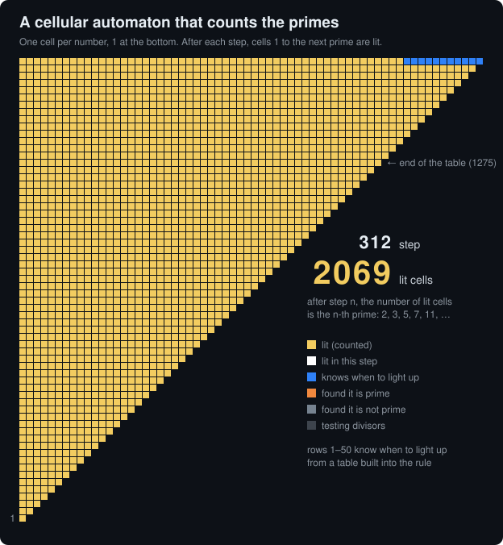

# CAS3: can a cellular automaton count out the primes?

<p align="center">
  
</p>

A **cellular automaton** is a grid of cells that all follow the same rule. At every step, each
cell looks at its immediate neighbours and decides what to become next. The best-known example is
Conway's Game of Life.

This project asks a simple question:

> Is there a rule, in some number of dimensions, so that if you start with one lit cell and keep
> applying the rule, the number of lit cells is always the next prime?

```
step        0   1   2   3   4   5    6    7    8    9    10   ...
lit cells   1   2   3   5   7   11   13   17   19   23   29   ...
```

## The short answer

- **No simple rule does it.** We searched every rule in many families of simple rules (the
  Game of Life is one of them), from every possible starting pattern, on square, hexagonal and
  cubic grids, in up to 21 dimensions, and with cells that have 3 or 4 states instead of just on
  and off. The best simple on/off rule follows the primes as far as 2, 3, 5, 7, 11, 13, 17 and then
  gives 21. Rules that match longer stretches, including those with more states, only manage it
  by memorising the list.
- **A rule that does it exists, and we built one.** It is the animation above. Its cells do more
  than switch on and off: each one quietly works out whether its number is prime, and exactly when
  its turn comes to light up.
- **You don't need 3D.** The rule above is two-dimensional and exact for the first 10¹⁷ steps,
  after which its 64-bit numbers overflow. A three-dimensional version, which stacks the digits of
  huge numbers, is exact forever with only a limited amount of information in each cell. Laying
  those stacks flat should do the same in 2D, but that hasn't been built.
- **One dimension is impossible**, for any rule at all: a line of cells can't grow fast enough.
- **No rule can jump from a prime to the next one in a fixed number of steps** if it starts from
  the prime alone, in any number of dimensions (with bigger primes laid out by adding cells to
  smaller ones). The rule above takes one step per prime only because its hidden machinery has
  been working ahead since the start.
- **From the prime alone, the next prime takes about √p steps.** We built a rule that turns p lit
  cells into exactly the next prime's number in about 2.4√p steps (checked for every prime up to
  100 billion). We also proved that for the hardest primes every rule needs a number of steps
  proportional to √p. So ln p steps is out of reach.

## Demo

The animation at the top is drawn straight from the real rule. In it:

- every square is one number: 1 is at the bottom left, the next row holds 2 and 3, the next 4, 5
  and 6, and so on;
- **gold** cells are lit, and they are the ones being counted. After step n, the cells from 1 up to
  the n-th prime are lit;
- **white** cells lit up in this very step: each step lights the stretch up to the next prime;
- **blue** cells already know the exact step at which they will light up;
- the cells above the "end of the table" mark work this out for themselves. **Dark grey** means
  still testing divisors, then comes **grey** (not prime) or **orange** (prime), then blue. The
  rows below the mark take their timing from a small table built into the rule (see below).

You can also watch it in a terminal:

```
cargo run --release -- demo
```

It shows the first 16 rows up close, with their numbers, then zooms out to 64 rows to show the
cells at work. `--speed 2` plays it twice as fast and `--plain` prints the frames as text. Here
are two steps of the plain output (lit cells are in brackets):

```
    11   12   13   14   15
  [  7]   8    9   10
  [  4][  5][  6]
  [  2][  3]
  [  1]

  step 4: 7 cells are lit, and 7 is the 4th prime
```

```
    16   17   18   19   20   21
  [ 11]  12   13   14   15
  [  7][  8][  9][ 10]
  [  4][  5][  6]
  [  2][  3]
  [  1]

  step 5: 11 cells are lit, and 11 is the 5th prime
```

To check many more steps than the animation shows, `cargo run --release -- primeca --steps 20000`
runs the automaton for 20,000 steps (up to the prime 224,737) and checks the count after each one.

## How the automaton works

**One cell per number.** The cells form a staircase: row 1 holds the number 1, row 2 holds 2 and
3, row 3 holds 4, 5 and 6, and so on. Each row is one cell longer than the row below and carries
on counting where that row stopped. New rows are added at the top as the automaton runs, a little
ahead of when they are needed.

**Each cell lights up at the right moment, and stays lit.** The cell for the number n lights up at
step "1 + the number of primes smaller than n". Take cells 8, 9, 10 and 11: each has four smaller
primes (2, 3, 5 and 7), so all four light up at step 5. After step 5 the lit cells are exactly 1 to
11, which makes 11 cells, and 11 is the 5th prime. The same happens at every step: after step n,
the lit cells are 1 up to the n-th prime.

**So every cell has to find out how many primes are smaller than its number, before its moment
comes.** A cell can only talk to its eight neighbours, so this happens in stages:

1. **Am I prime?** The cell tries dividing its number by 2, 3, 4, … one divisor per step, until
   one divides it or the divisor passes the square root.
2. **Count along the row.** Starting from the right-hand end of each row, every cell tells its left
   neighbour how many primes there are from there to the end of the row.
3. **Running total up the left edge.** The first cell of each row hears from the row below how many
   primes there are in all the rows below. It adds its own row's primes and passes the total up.
4. **Back along the row.** The total is passed to the right, cell by cell. Each cell subtracts the
   primes from itself to the end of its row, which leaves the number of primes smaller than itself.
5. **Wait.** Every cell carries a clock, and lights up when the clock reaches its moment.

**Why it is never late.** This work takes about √n steps (testing divisors) plus a few times the
row length (passing counts along). The moment of cell n comes after about n / ln n steps, which
grows much faster. So high enough up, every cell is ready long before its moment: in the
animation, the blue always stays ahead of the gold. Near the bottom there isn't enough time, so the
rule contains a small table with the moments of the first 50 rows (the numbers 1 to 1,275). With a
40-row table the cells would be only just on time, and with 30 rows they would be late.

**What a cell holds.** Besides its visible on/off switch, a cell carries a few hidden whole
numbers: its own number, its row, the clock, the divisor it is trying and its counts. Only the
switch is counted. In cellular-automaton terms, each cell has a very large but finite number of
possible states, where the Game of Life has two (on and off).

**Lasting forever: the 3D version.** The 2D version stores each hidden number as a 64-bit integer,
which eventually overflows: it is exact for every step before step 114,179,426,570,746,131 (about
10¹⁷). A true cellular automaton must have a fixed, finite set of possible states, so its cells
can't hold numbers that grow without limit. The 3D version fixes this. Once numbers get too big for
one cell, each number becomes a stack of digits rising into the third dimension, one 64-bit digit
per cell. The stack grows taller as the numbers grow, so there is no limit. Every stage above is
then done digit by digit, like adding and dividing by hand, with carries passed up the stack. Until
stacks are needed (around step 1.5 × 10¹⁶), the 3D version is exactly the 2D version.

## Why no simple rule works

Before building anything, we searched. The project's original search wrote rules as logical
formulas and tried them one by one; it was so slow that it was only practical in one dimension. The
new search engine is many orders of magnitude faster because it:

- only fills in the parts of a rule that the simulation actually uses, so one failed run rules out
  a whole family of rules at once;
- drops a rule as soon as a step gives the wrong count;
- treats rules that are rotations or mirror images of each other as one;
- covers every possible starting pattern by checking just a handful of two-cell patterns, with a
  proof that nothing else needs checking.

What it found:

- **Simple, symmetric rules fail fast.** From any starting pattern, Life-like rules on a square
  grid get only as far as 2, 3, 5. The best simple family is on a hexagonal grid, and it gets 2, 3,
  5, 7, 11, 13, 17 and then 21.
- **More dimensions make it worse.** In more dimensions a symmetric rule ties more cells together,
  so the count jumps by too much at once. For two large families this is proven for every
  dimension; for example, no Life-like rule in 3 or more dimensions can even produce 2, 3, 5.
  Symmetric families were checked up to 21 dimensions, and other families up to 10.
- **The cheapest near-misses are fooled by 25.** The simplest rules that get furthest actually
  produce the numbers that aren't divisible by 2 or 3: 5, 7, 11, 13, 17, 19, 23, and then
  25 = 5 × 5.
- **One cell can't even start.** A rule that treats all directions alike can never turn one cell
  into 2 or 3: everything it grows from one cell comes in symmetric groups of 4 or more cells. That
  holds on square, hexagonal and cubic grids in any number of dimensions, however many states a
  cell has.
- **Longer matches are memorisation.** With big enough rule tables, a search matched 72 primes in a
  row. But each extra prime cost about three more table entries: the rule was storing the list,
  not producing it. For simple sequences such as 1, 2, 3, 4, … or the square numbers, the number of
  entries needed stops growing straight away. For the primes it never did.

### More states per cell

Maybe on/off cells are just too plain. So we also searched rules whose cells have 3 or 4 states,
like colours. We tried two ways of counting: every non-empty cell counts, or only one state counts
and the others are hidden helpers, like the hidden machinery of the rule we built.

Extra states let a rule match far more primes than on/off rules of the same kind, but only as many
as its table can store. Every few primes need new table entries, and the best rules use almost
their whole table. Here are the 3-state rules that treat all directions alike, from any starting
pattern:

| 3-state rules | table entries | longest run of primes found | entries that rule uses |
|---|---|---|---|
| Life-like, 4 neighbours | 44 | 19 (2 to 67), and no rule of this kind does better | 43 |
| direction-blind, 4 neighbours | 62 | 22 (2 to 79) | 57 |
| Life-like, hexagonal grid | 83 | 27 (2 to 103) | 79 |
| Life-like, 8 neighbours | 134 | 30 (2 to 113), as far as we asked | 99 |
| direction-blind, hexagonal grid | 275 | 30, as far as we asked | 111 |
| direction-blind, 8 neighbours | 2,861 | 30, as far as we asked | 140 |
| Life-like, 3D, 6 neighbours | 83 | 4 (2 to 7), and no rule of this kind does better | 7 |
| direction-blind, 3D, 6 neighbours | 167 | 30, as far as we asked | 114 |
| Life-like, 3D, 26 neighbours | 1,133 | 30, as far as we asked | 215 |
| direction-blind, 3D, 26 neighbours | about 159 billion | 30, as far as we asked | 308 |

("Life-like" rules look only at how many neighbours are in each state; "direction-blind" rules
look at the whole pattern of neighbours, up to rotations and reflections.)

Going to 3D doesn't help. The 3D Life-like rules with 6 neighbours can't get past 2, 3, 5, 7 (we
checked every one), while their 2D cousins with 4 neighbours reach 67, most likely because in 3D,
symmetry ties cells together in bigger groups. The 26-neighbour 3D rules found for 30 primes use
about twice as many entries as the 8-neighbour 2D ones. With 4 states per cell, every family
reaches 30 primes, but its table is bigger too: the rules found use 101 to 308 entries to do it.
Hidden helpers mostly make the rules bigger, not better.

The difference shows best next to a sequence that a rule really can generate. In the smallest of
these classes (3-state Life-like rules on the 4-neighbour grid, 44 table entries) we could check
every rule. This is the smallest rule that matches the first terms of each sequence:

| terms matched | 2 | 3 | 4 | 5 | 6 | 7 | 8 | 9 | 10 | 11 | 12 | 13 | 14 | 15 | 16 | 17 | 18 | 19 | 20+ |
|---|---|---|---|---|---|---|---|---|---|---|---|---|---|---|---|---|---|---|---|
| counting numbers 2, 3, 4, … | 3 | 6 | 9 | 9 | 9 | 9 | 9 | 9 | 9 | 9 | 9 | 9 | 9 | 9 | 9 | 9 | 9 | 9 | 9 |
| primes 2, 3, 5, … | 3 | 6 | 6 | 10 | 12 | 16 | 18 | 20 | 21 | 24 | 26 | 28 | 29 | 34 | 36 | 38 | 42 | 43 | none |

For the counting numbers, a 9-entry rule takes over at the 4th term and then runs on by itself; we
checked it to 300. For the primes, the smallest rule grows by about 2 to 3 entries per prime. At
19 primes (2 to 67) it needs 43 of the 44 entries, and no rule of this kind matches a 20th. The
bigger 8-neighbour class behaves the same way: 22 entries cover the counting numbers (again checked
to 300), while the primes need 28 entries for their first 12 terms and keep growing. That is
memorising: more states just make a bigger table to store the answers in.

### Could the primes come about naturally?

Our rule finds the primes by checking them, which can feel like cheating: you'd want a rule whose
count just *turns out* to be the primes. That is exactly what the searches looked for, and the
findings above all point the same way:

- the simplest near-misses are filters that skip multiples of 2 and 3. To go past 25 a rule needs
  a new filter for 5, then 7, then 11, forever: ever-growing machinery that is, in effect, finding
  primes;
- rules that treat all directions alike, as physical laws do, can't even start from one cell;
- every long match, with any number of states, stores the primes rather than producing them.

So any rule whose count is exactly the primes has to work them out somewhere. Even the Game of
Life's prime machine does, with colliding gliders. "Natural" can only mean that this work is hidden
inside simple-looking behaviour, not that it's absent. We can't prove that no simple rule exists,
but every search points that way. That is why we built one instead.

**What was known before.** Cellular automata can already signal the primes in time. A known
one-dimensional automaton (Fischer, 1965; Korec, 1997) switches one particular cell on exactly at
the prime-numbered steps, and the Game of Life has a pattern that does something similar
(Hickerson's "Primer", 1991). We know of no earlier work on the version asked here, where the
number of lit cells must be the primes.

## Does the number of dimensions mean anything?

It is tempting to read something deep into the dimension, for instance about how many dimensions
the universe has. What this project shows is more modest:

- **1D is ruled out for a simple reason.** A line of cells can only grow by a fixed number of cells
  per step, but the primes eventually outgrow that (the n-th prime is roughly n × ln n).
- **2D is enough.** A flat sheet has plenty of room, and the rule above works there.
- **3D was used for convenience**, to give each big number room to stack its digits. It could most
  likely be flattened back into 2D.
- **3D doesn't help simple rules either.** In our searches, 3D rules used more table entries per
  prime than 2D ones, and the smallest 3D family stops at 7. In 3D, symmetry ties more cells
  together, so the count jumps too far at once.
- **No number of dimensions rescues a direction-blind rule from a single cell.** If the rule treats
  all directions alike and everything starts from one cell, the count can never even reach 2, in
  any dimension.

So the dimension tells you how much room a computation needs, not something about prime numbers or
about physics.

## Can a rule jump to the next prime in a fixed number of steps?

Our automaton lights up the next prime one step after the last one. But that's because its hidden
machinery has been working ahead since the start: each step shows a result it worked out earlier.
What if you hand a rule just a prime, as that many lit cells, and ask for the next prime within,
say, 5 steps, whatever the prime? **No rule can do that, in any number of dimensions**, however
many states its cells have, if each prime is laid out as the previous one plus the new lit cells
(a line, our staircase, a spiral, any fixed order), even on top of a fixed pattern of helper
cells.

The reason is that information travels at a limited speed. In one step a cell only hears from its
neighbours, so in 2D one extra lit cell in the input can change at most 9 cells of the output.
Now take two primes in a row, 1,667 and 1,669. Their inputs differ by 2 cells, so their outputs
can differ by at most 2 × 9 = 18 cells. But the outputs should be the next primes, 1,669 and
1,693, which are 24 apart. So no one-step rule in 2D works.

More steps or more dimensions only push the problem further out. Each one lets a cell hear from
further away, but the gaps between primes can jump by any factor: somewhere, a short gap is
followed by one as many times longer as you like. Pintz proved this in 2014, settling a question
Erdős asked in 1955. We list the biggest jumps up to 100 billion. The largest is a gap of 2
(94,746,870,539 to 94,746,870,541) followed by a gap of 402. With cells that see only their
immediate neighbours, primes in that range alone rule out every rule that finishes within 6 steps
in 2D, 2 in 3D or 1 in 4D, and Pintz's result rules out every fixed number of steps.

If the rule has to work however the cells are arranged, it fails even sooner. Two lit cells far
apart (the prime 2) grow as two separate copies of one cell, so they always end with an even
number of lit cells, never 3.

What about a layout that rearranges the cells from one prime to the next? In a fixed number of
steps, each output cell depends only on a small patch of the input, so the final count is just a
tally of the small patterns in the input. For that tally to be the next prime, the layout itself
would have to encode the gap to the next prime: the layout would be doing the work.

So "the next prime in constant time" exists only in the sense our automaton already has: one step
per prime, with the work done in advance. It doesn't make finding primes any faster.

## How fast can a rule find the next prime from scratch?

So what is possible? We built a rule that starts from nothing but the prime, as p lit cells in our
staircase. It ends with exactly the next prime's number of lit cells and stays there. Here it is
for 23 (top row first), at the start and 24 steps later with 29 lit cells. The `o`s are
candidates it checked but didn't need:

```
start: 23 lit       step 24: 29 lit
##                  ########ooo
######              ######
#####               #####
####                ####
###                 ###
##                  ##
#                   #
```

It works in three stages:

1. **Find out what p is.** Starting from the bottom corner, the cells number themselves row by
   row, and the end of the top row learns that it is cell p. That takes one step per row, about
   √(2p) steps.
2. **Try the next numbers.** That cell grows a line of candidates p + 1, p + 2, … to its right,
   and each candidate tests itself for divisors, one per step: about √p steps.
3. **Light up to the first prime.** The candidates light up in order while they turn out composite,
   and the first prime lights up last and stops the line.

In total it takes about 2.4√p steps: about √(2p) to find p, about √p to test the next prime, and
two more per number in between. That last part is small because gaps between primes are small
next to √p, as far as anyone has checked (nobody has proved they always are). For 999,999,937 it
comes to 76,483 steps. We checked every starting number up to 10,000 by running the rule, and every
prime up to 100 billion with its exact timing formula: never more than 5.7√p steps.

**No rule can do fundamentally better with this input**, whatever its cells can hold. We proved
that for the hardest primes, every rule needs a number of steps proportional to √p (at least about
√p/20 once p is large). In fewer steps, each cell has seen only a small piece of the staircase.
From small pieces, the count a rule can produce changes smoothly as the staircase grows, so it
can't follow the irregular gaps between primes.

So ln p steps (about 21 for primes near a billion) is far out of reach, because √p grows much
faster. More dimensions should help, since information reaches every cell sooner: the same
argument suggests about p^(1/d) steps in d dimensions (we haven't proved that case), still far
above ln p in any fixed dimension. Writing p out in binary as well wouldn't simply fix it. If cells
can hold whole numbers, one cell could look the answer up in a single step, which says nothing
about computing. With cells that hold only a few bits, the standard primality tests do about ln p
multiplications one after another, and on a grid each takes longer the more digits there are.

## How we know it works

- **Two separate simulators** run the 2D rule. One updates every cell at every step; the other
  updates only the cells that can change. They agree cell by cell, and the count equals the n-th
  prime after every one of the first 20,000 steps, up to the prime 224,737.
- **A timing certificate** shows that every cell is ready before its moment, for every row the
  64-bit version can hold. It uses a proven lower bound on how many primes there are (Dusart,
  2010). The closest call is row 52, with 26 steps to spare (31 in the actual simulation).
- **The 3D version** was checked in four ways:
  - It was run with tiny digits (3 to 16 bits) so that stacks appear after a few rows, and counted
    correctly at every step up to the prime 12,853. Tiny digits make the work slow, so these runs
    start the clock late.
  - Its arithmetic was tested with full-size 64-bit digits, including where stacks grow a new
    digit.
  - Its countdowns were tested with the real clock.
  - A timing certificate covers every row, forever: numerically up to row 10¹⁵⁰, and by an
    estimate beyond. In the worst case the cells need at most 27% of the time they have.
- **The searches were cross-checked.** With two states, the search for rules with more states
  gives exactly the results of the original on/off searches. On a small 3-state class it gives
  exactly what trying every one of its 129 million rules by brute force gives.
- **The tests can fail.** Bugs planted on purpose in the countdown logic and in the searches are
  all caught. Run `cargo test --release` for the whole suite.

## What this is not

- **It is not a simple rule.** It is closer to a small program running in every cell. The searches
  strongly suggest that no simple rule exists, though that can't be proven for every rule.
- **Cells hold hidden numbers.** Only the on/off switch is counted, but cells carry extra
  information. A version where every cell is purely on or off, like the Game of Life, was started
  (see "Constructive route" in the [technical notes](docs/technical-notes.md)) but isn't finished.
- **The first 1,275 numbers come from a table.** The table is a fixed, finite part of the rule, but
  it is a lookup, not a computation.
- **The 3D version hasn't been run at full scale.** Its stacks only start after about 10¹⁶ steps.
  Its correctness there rests on testing each mechanism with full-size 64-bit digits and on the
  timing certificate.

## The open problem: only on and off

The real prize is the strict version, and it is still unsolved:

1. Each cell is either on or off.
2. Every cell follows the same rule, which looks only at the cell and its 8 neighbours. An off cell
   with no on neighbours stays off.
3. It starts with 2 cells on.
4. After every step, the number of on cells is exactly the next prime: 2, 3, 5, 7, 11, 13, …
   forever.

There are about 10¹⁵⁴ such rules, and only five essentially different starting pairs matter (two
cells further apart always end up with an even count). Where things stand:

- **The best rule found follows the first 76 primes** (2 to 383), starting from two cells
  diagonally two apart. At step 76 it has 398 cells on instead of 389. It gets that far by
  memorising: it uses 485 of the 512 possible neighbourhood patterns, about 6 per prime, so this
  kind of fitting runs out of table long before 10,000 primes. A rule that gets that far would
  have to compute the primes.
- **No small rule works.** Every rule using fewer than 44 of the 512 patterns goes wrong within the
  first 12 primes, from any starting pattern.
- **Building one by hand is hard** because every on cell counts, including all the machinery that
  would work out the primes. That machinery would have to keep its own count exactly predictable
  at every step, whatever it is computing. An earlier attempt here did this with blocks that always
  hold the same number of on cells, but it needed cells to see further than their 8 neighbours,
  and it was never finished.

`cargo run --release -- onoff --rule <128 hex digits> --seed "0,0;1,0"` checks any candidate rule
against the first 10,000 primes. Passing would still not be proof that it works forever.

### Even with a few dozen states per cell

Allowing each cell a few dozen states, with only some of them counting as lit, doesn't remove the
main difficulty. That version is open too.

- **The rule has to test more and more numbers per step.** By step t it must have worked out the
  next prime, about t·ln t, so it has to settle about ln t numbers per step, and that keeps
  growing.
- **Known prime-generating automata are too slow.** The smallest ones (8 to 11 states) settle one
  number per step: a special cell lights up at step n exactly when n is prime.
- **Running several in parallel isn't simple.** Each parallel lane needs its own timing for every
  prime, the machinery for different primes must not get in each other's way, and the number of
  lanes has to grow forever.
- **Our two sketched designs are too big.** Both would need well over a hundred states (see the
  [technical notes](docs/technical-notes.md)), and a literature search found no known
  construction.

## Run it yourself

You need Rust (`cargo`).

| command | what it does |
|---|---|
| `cargo run --release -- demo` | watch the automaton in the terminal |
| `cargo run --release -- demo --svg docs/demo.svg` | redraw the animation at the top of this page |
| `cargo run --release -- primeca --steps 20000` | run the 2D automaton and check the count after every step |
| `cargo run --release -- primeca --certificate` | timing certificate for the 2D version |
| `cargo run --release -- primecols --certificate` | timing certificate for the 3D version |
| `cargo run --release -- primecols --w 4 --k 6000 --rows 40` | run the 3D version with 4-bit digits, so stacks appear from row 2 |
| `cargo run --release -- search --class totalistic --any-start --terms 30` | try every Life-like rule from every starting pattern |
| `cargo run --release -- sweep --min-dim 2 --max-dim 21 --terms 14` | symmetric rule families in 2 to 21 dimensions |
| `cargo run --release -- multistate --grid vn --terms 30` | every 3-state Life-like rule on the 4-neighbour grid, from every starting pattern |
| `cargo run --release -- multistate --grid vn --profile --terms 30` | the smallest such rule for each stretch of the primes (takes several minutes) |
| `cargo run --release -- multistate --grid vn --profile --target naturals --terms 30` | the same for the counting numbers |
| `cargo run --release -- multistate --grid cube-vn --terms 30` | the same family in 3D, where nothing gets past 7 |
| `cargo run --release -- multistate --states 4 --battery --terms 30 --node-limit 3000000` | every 4-state grid and family |
| `cargo run --release -- constant-time` | the primes that rule out a one-step jump to the next prime in 2D (try `--dim 3 --steps 2`) |
| `cargo run --release -- constant-time --records --limit 100000000000` | every record jump between prime gaps up to 100 billion |
| `cargo run --release -- next-prime --show 23` | watch the from-scratch rule turn 23 lit cells into 29 |
| `cargo run --release -- next-prime` | run it from every starting number up to 2,000 and time it for every prime up to 100 million |
| `cargo run --release -- onoff --search --terms 120 --time-limit 300` | search on/off rules for the strict goal and print the best ones found |
| `cargo run --release -- onoff --rule <hex> --seed "-1,-1;1,1"` | check any on/off rule against the primes (try the 76-prime rule in `src/onoff.rs`) |
| `cargo run --release -- help` | every command and option |
| `cargo test --release` | the test suite |

## What's in the repository

| file | what it holds |
|---|---|
| `src/prime_display.rs` | the 2D automaton, its two simulators and its timing certificate |
| `src/prime_columns.rs` | the 3D version, with numbers as stacks of digits |
| `src/demo.rs` | the terminal demo and the animation |
| `src/table_search.rs`, `src/rule_class.rs`, `src/dimension_sweep.rs`, `src/lattice.rs` | the searches for a simple rule |
| `src/multi_state.rs` | the search over rules whose cells have 3 or more states |
| `src/constant_time.rs` | why no rule jumps to the next prime in a fixed number of steps, and the primes that show it |
| `src/bare_prime.rs` | the rule that finds the next prime from the prime alone in about √p steps, and why none is much faster |
| `src/onoff.rs` | the strict on/off goal: checking any rule against the primes, and the best rule found |
| `src/bounds.rs` | the impossibility proofs (one dimension, symmetric rules) |
| `src/construct.rs`, `src/prime_worker.rs`, `src/scheduler.rs` and others | the unfinished on/off-only construction |
| `src/state_explorer.rs`, `src/space.rs`, `src/rule.rs` | the original formula-based search (`legacy`) |
| `docs/technical-notes.md` | the detailed record: every search result, proof sketch and design decision |

## Where this started

Prime numbers are intriguing: every other number is built from them. This project began as a
search over rules written as formulas, dimension by dimension, hoping to find a pattern whose cell
count is the primes. That first search found rules for sequences such as 1, 2, 3, 4, …, the odd
numbers and the squares, and once 1, 3, 5, 9, 11, 15, 19, 27, but never the primes. The rest of
the story is above.


Contributions are welcome. If you can make the search faster, or find a simpler rule, open a pull
request.
