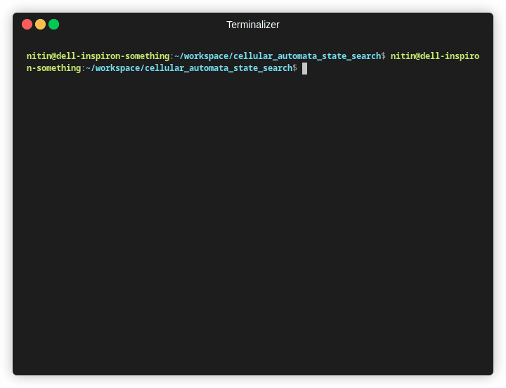

# CAS3 technical notes

The detailed record of the project: the search engine and its validation, every search result, the
impossibility proofs, the constructions and how they were checked. For a plain-English overview and
the demo, see the [README](../README.md).

## Original introduction

Prime numbers are intriguing, they compose all other numbers. Cellular automata is a computational paradigm which has a simple set of rules, works in an N-dimensional grid with a start state, and rules being applied iteratively to every cell in parallel. The rules have input as a cell's immediate neighbours, and output as a state of the cell. For simplicity, the state can be thought of as ON or OFF.

This project attempts to figure out if there is an N-dimensional cellular automata which will generate the prime number sequence. The resulting cell-cluster would combine to form all other numbers in our universe!  

This project is not computationaly feasible, and is hence a learning project. Contributions are welcome, if you think you can make it do the search faster, do ping me or send in a PR.

I found it generating rules for sequence such as :
<br/>1,2,3,4..
<br/>1,3,5,7..
<br/>1,4,9,16,25,36..
<br/>The most interesting I've found has been 1, 3, 5, 9, 11, 15, 19, 27



### Space
Start with one cell, apply rules. If successful, the applied rules would produce blocks of cells which are set, and the number of cells in such a block would be prime numbers :D

### Cell
N-dimensional vector (Co-ordinates) + Value. Value is either Set or Unset

### Rule

One rule specifies which neighbours to check, what check to be done and what rule should be applied.

Which neighbours to check -  This is defined by the "elements" vector, where each element has 3 values: SameCoordinate, Positive, Negative
As expected of the naming, when this rule is checked against a cell, it'll check it's neighbours, changing ith coordinate accordingly (SameCoordinate - no change, Positive - +1, Negative - -1)

What check to be done – Is whether the specified neighbours are set or not set. Rule has ExpectedCellValue which checks if the neighbours are as expected

What rule should be applied – Is whether the corresponding cell should be set, unset or flipped in value. RuleResult does this.


### Dimensions

Number of dimensions of the universe is unknown. We need to generate for increasing numbers, starting at 3 (since we live in 3 dimensions)


State space search:
Stop the search if successive applications of rule is not producing the next prime number in sequence (1,2,3,5,7,11,13...)

### Search Space Pruning (legacy expression search)

Following techniques has been applied to reduce the search space of the original expression-tree enumeration (`legacy` command). The rule-table search below goes a lot further.

* We generating boolean expressions of N variables, would only generate half the tree. The other half is symmetric, and gets 
handled by the permutation we apply to input variables. So for three variables, we generate from `(A AND B AND C)` to `(A AND (B OR C))`, we won't generate `((A OR B) AND C)`
* Input variables are clustered if they share the same op next to each other. For ex. `(A AND (B AND C))` clusters `[A,B,C]`. `(A AND (B OR C))` clusters as `[[A],[B,C]]`. These are clustered as the variables can be changed with each other without affecting output for the expression, so no value in permuting on them.
* We generate permutation of input variables based on clusters. So we generate `[[B],[A,C]]`, `[[C],[B,A]]` but not `[[A],[C,B]]`.
* Since we generate all boolean expressions, for cases like `(A AND (NOT B OR C))`, even if we are not permuting (A, B), we will search for the rule `(A AND (B OR NOT C))` as well
* Not exploring rules with action "Unset", they are lame

## Reducing the search space: exact rule-table search

The expression enumeration walks a *syntactic* space: formulas and input permutations. The `space` command shows how fast it grows (before the input permutations tried for each structure):

| dimension | inputs (3^N) | expression structures per boolean function | (birth, survival) pairs | unrestricted tables |
|---|---|---|---|---|
| 1 | 3 | 32 | 1,024 | 2^7 |
| 2 | 9 | 6,160,384 | 37,950,331,027,456 | 2^511 |
| 3 | 27 | 1,077,835,798,265,866,175,381,504 | > 3.4e38 | 2^134,217,727 |

The new `search` engine (`src/table_search.rs`) works on the *semantic* space instead. A rule is a pair of lookup tables over neighbour patterns (BIRTH for an unset cell, SURVIVAL for a set cell). The CA is simulated from the single seed cell, and a table entry is only decided the first time the simulation needs it. Each node of the search tree is therefore one distinct trajectory, and a partial table stands for every full rule that agrees with it. Everything below is exact (no heuristics) unless it says otherwise.

| technique | what it removes | measured |
|---|---|---|
| **Prefix pruning** | a step must produce exactly the next target count, so only entry combinations that sum to it are generated | 2D Moore, first 6 primes: 9.8 million rule classes covering ~2^498.7 of the 2^511 rules, found by visiting 9.86 million nodes in 0.16 s |
| **Lazy tables** | rules that differ only in entries the simulation never consults are one node, not 2^N | one failed simulation discards a whole family of rules |
| **Quiescent space, cell is not an input** | the all-zero birth entry (empty space stays empty) and the always-known own state | tables over the 3^N − 1 neighbours instead of 3^N inputs per function |
| **Lattice symmetry** | rules whose evolutions are mirror images have identical counts, so only the lexicographically smallest trajectory prefix in each orbit is explored (works for any neighbourhood, with its own symmetry group: orders 2, 8, 48) | 7.97× – 8.00× fewer nodes in 2D (group order 8): 215,649 → 27,057 (5 terms), 78.8 M → 9.86 M (6 terms) |
| **Entry bound** (`--max-entries`) | only rules that consult at most E table entries; exhaustive search for the simplest rule | 2D Moore, 7 primes: exhaustive in 5,858 nodes at E ≤ 28, versus > 3.3 billion nodes unbounded |
| **Smaller neighbourhoods** (`scan`, `--neighbourhood vonneumann`, `--offsets`) | rules that depend on at most r neighbours, one representative per symmetry orbit of neighbour subsets | all 2D rules using ≤ 4 neighbours: 13 classes, 1,496 nodes, a few milliseconds |
| **Parallelism** | top of the tree split over rayon workers | 5.2× on 10 cores (0.93 s → 0.18 s) |

### How the reductions were validated

* Search vs exhaustive enumeration: for neighbourhoods small enough to enumerate every full rule, the number of rules matching a target (the sum of 2^free-entries over solutions, weighted by symmetry orbit size) equals a brute-force count made with an independent bounded-grid simulator. Covered: symmetry groups of order 1, 2 and 8, all three survival modes, with and without symmetry, sequential and parallel.
* One-off exhaustive check over **all 2^31 rules** of the planar von Neumann class (`cargo test --release -- --ignored`, about 7 minutes): 33,554,432 rules match 1, 2, 3, 5 (the search reports the same number) and none match 1, 2, 3, 5, 7.
* Symmetric and non-symmetric searches produce identical rule-count histograms in 2D (order 8) and 3D (order 48, dense and sparse tables).
* The grid simulator agrees with a naive reference simulator, which agrees with the original `Space` engine on 2,800 random expression rule sets (`state_explorer` test).
* Every solution printed by the CLI is re-simulated by the reference engine, also with random completions of the entries it did not consult.

### How to read the results: description length

An unrestricted lookup table can fit any short prefix. In 2D with the Moore neighbourhood the search finds a rule for all 10 first primes in under a millisecond, but it consults 96 table entries to do it: it memorises. So "does a rule exist" is not the interesting question. `profile` asks how many table entries a rule *must* consult to reproduce the first L terms (the exact minimum, by iterative deepening on the entry bound). A rule that really generates a sequence makes this curve flatten; a memoriser needs more entries for every extra term. 2D Moore, free survival:

| terms reproduced | 2 | 3 | 4 | 5 | 6 | 7 | 8 | 9 | 10 | 11 | 12 | 13 |
|---|---|---|---|---|---|---|---|---|---|---|---|---|
| 1, 2, 3, 4, … | 9 | 10 | 10 | 10 | 10 | 10 | 10 | 10 | 10 | 10 | 10 | 10 |
| 1, 3, 5, 7, … | 9 | 14 | 14 | 14 | 14 | 14 | 14 | 14 | 14 | 14 | 14 | 14 |
| 1, 4, 9, 16, … | 9 | 16 | 16 | 16 | 16 | 16 | 16 | 16 | 16 | 16 | 16 | 16 |
| **primes 1, 2, 3, 5, 7, 11, …** | 9 | 10 | 14 | 19 | 23 | 29 | 31 | 33 | 33 | 41 | 45 | 48 |

The sequences that simple CAs generate plateau at once (the 10-entry rule for 1, 2, 3, 4, … is a diagonal line growing both ways); the primes keep growing by about 3.5 entries per term. Counts that double every step (1, 2, 4, 8, …) cannot continue past 9 terms in 2D (a cluster has at most (2t+1)² cells at time t), and the profile shows the cost exploding long before that: 9, 11, 18, 26, 42 entries for 2 to 6 terms, and more than 57 for 7 terms (not settled within the time limit).

### Results

All results are for the first terms of 1, 2, 3, 5, 7, 11, 13, … (the seed counts as the first term) and exhaustive, unless marked partial.

* **1D, radius 1 (3 cells):** no rule reproduces more than 1, 2, 3 (all 2^7 rules, 5 nodes). Radius 2 reaches exactly 10 terms (1 … 23) and nothing beyond; radius 3 reaches at least 26 within a 60 s cap (partial).
* **Axis-only neighbourhood (von Neumann), dimensions 2 to 6:** no rule reproduces more than 1, 2, 3, 5. More dimensions do not help.
* **Rules depending on at most r neighbours of the Moore neighbourhood (`scan`),** every class exhausted, so every entry is a proven "dead" verdict (no rule in the class reproduces more terms):

  | r | 1 | 2 | 3 | 4 | 5 |
  |---|---|---|---|---|---|
  | longest prime prefix, **2D** (3×3 block) | 3 | 3 | 5 | 10 | 22 |
  | longest prime prefix, **3D** (3×3×3 block) | 3 | 3 | 5 | 10 | not run |
  | neighbour classes (2D / 3D) | 2 / 3 | 6 / 17 | 10 / 84 | 13 / 399 | 10 / – |

  The r = 5 row took 165 s and 298 million nodes (`scan --dim 2 --min-arity 5 --max-arity 5 --terms 40`): one class reaches 22 terms, three reach 21, five reach 20 and one stops at 10. The third dimension does not buy any extra terms at a fixed number of neighbours, and the capacity roughly doubles with every extra neighbour. Neighbours do not have to be adjacent: drawing them from a larger block (`--universe-radius R`, 2D) barely changes the picture.

  | neighbours drawn from the block of radius R | r = 1 | r = 2 | r = 3 | r = 4 | classes at r = 4 |
  |---|---|---|---|---|---|
  | 1 (3×3) | 3 | 3 | 5 | 10 | 13 |
  | 2 (5×5) | 3 | 3 | 5 | 12 | 1,391 |
  | 3 (7×7) | 3 | 3 | 6 | 12 | 24,630 |
  | 4 (9×9) | 3 | 3 | 6 | 14 | 198,654 |
  | 5 (11×11) | 3 | 3 | 6 | 14 | 1,029,135 |
* **Cells that never die (survival always on), full 2D Moore neighbourhood:** nothing beyond 1, 2, 3, 5, 7, 11, over all 2^255 birth tables (9 nodes). Cells that die after every step form a far richer class: at least 34 terms (partial), and its minimal rule size still grows (8, 9, 13, 17, 20, 25, 27, 29, 29, 37, 41, 44, 46, 49, 54, 55 entries for 2 … 17 terms).
* **Description length per geometry (primes, entries needed for L = 2, 3, …):**
  1D radius 2: 5, 6, 9, 14, 19, 22, 22, 22, 22, then no rule; 1D radius 3: 7, 8, 12, 18, 22, 30, 30, 30, 30, 42;
  2D Moore: 9, 10, 14, 19, 23, 29, 31, 33, 33, 41, 45, 48; 3D Moore: 27, 28, 32, 41, 53, 65, 67.
  No flat tail was found in any class: prefixes of the primes can be fitted, but no compact generator.

The project's original question (is there a dimension in which a rule generates the whole prime sequence?) is not settled by this: it is a prefix test within the classes above, the classes beyond them are astronomically larger, and a flat profile in some unexplored class would be the sign to look for.

### Usage

```
cargo run --release -- help
cargo run --release -- search  --dim 2 --terms 10 --first          # any 2D rule for the first 10 primes
cargo run --release -- search  --dim 3 --neighbourhood vonneumann  # longest prime prefix, exhaustive
cargo run --release -- profile --dim 2 --terms 13                  # minimal rule size per prefix length
cargo run --release -- profile --dim 2 --target squares --terms 12 # a control sequence
cargo run --release -- scan    --dim 2 --max-arity 4 --terms 10    # every rule using at most 4 neighbours
cargo run --release -- construct --steps 5000 --show 8             # weighted prime-gap accounting certificate
cargo run --release -- worker --candidate 97                       # autonomous distributed trial division
cargo run --release -- candidate --candidate 97                    # 2D parallel divisor tile
cargo run --release -- pipeline --start 4 --lanes 2 --steps 220     # ordered CA-classification diagnostic
cargo run --release -- space   --max-dim 3                         # legacy search-space sizes
cargo run --release -- legacy  --min-dim 1 --max-dim 1             # the original expression search (dimension 2 needs ~3.8e13 expression pairs and is refused unless --force)
```

Add `--dashboard 8787 --hold` to `search`, `profile` or `scan` and open `http://127.0.0.1:8787` for a live monitor (loopback only): nodes per second, nodes per time step, how much of the target the best rule so far reproduces, the evolution of that rule, and the history of finished steps. `--time-limit`, `--node-limit` and `--max-entries` bound a run; an unbounded `search` on a large neighbourhood can run for a very long time.

### Scope and caveats

* A rule is a birth table and a survival table over the neighbours of a cell (the cell's own state selects the table). A single seed cell (or `--seed` / `--any-start`), synchronous updates and an empty quiescent background are assumed. The legacy `Space` engine only updates cells it has materialised, so a birth table that fires on an empty neighbourhood behaves differently there; those rules are outside the new engine's model.
* Matching a prefix is not a proof about the infinite sequence. Negative results are exact for the class and the prefix length that were searched.
* Limits: at most 62 neighbours (so the Moore neighbourhood up to 3 dimensions), symmetry reduction up to dimension 5, and `scan` up to dimension 5.
* Tests: `cargo test --release` (the legacy 2D test is slow); `cargo test --release -- --ignored` adds the 2^31 brute force.

## Can any class generate the whole prime sequence?

A finite search can never verify an infinite sequence, but it can *exclude* classes. A rule that generates the whole sequence reproduces every prefix, so if an exhaustive search proves that no rule of a class reproduces more than L* terms, the class contains no generator. Call such a class **dead**; `scan` prints this verdict.

### Two meanings of "generates the primes"

* **Population** (what this project asks): the number of set cells after t steps is the t-th prime, 1, 2, 3, 5, 7, ….
* **Time signal** (the classical meaning): one designated cell is ON at step t exactly when t is prime. Fischer (1965) showed that a one-dimensional cellular automaton can do this in real time, and Korec (1997, *Real-time generation of primes by a one-dimensional cellular automaton with 11 states*) reduced it to 11 states with radius 1 and to **2 states with radius 12**, starting from a single non-quiescent cell. In Conway's Life, a binary 2D rule with 8 neighbours (so a member of this project's own 2D Moore class), Dean Hickerson's Primer (1991, 2,953 cells) lets a lightweight spaceship escape at generation 120N + 100 exactly when N is prime.

So for the signal reading the answer is already "yes". I know of no result for the population reading in either direction. The known generators are large: Korec's 11-state table has 11³ entries, about 4,600 bits, against 511 bits for the whole 2D Moore class; the largest classes this tool has exhausted have 63 entries (5 neighbours, free survival) and 255 entries (2D Moore, cells never die).

### What can be said without any search (`src/bounds.rs`, tested)

* **One dimension, any radius: impossible.** After t steps every set cell is within r·t of the seed, so the population is at most 2rt + 1. The t-th prime exceeds t·ln t (Rosser), which is at least (2r + 1)·t once t ≥ e^(2r+1). From dimension 2 the bound (2rt + 1)^d grows faster than the primes and excludes nothing.
* **Symmetric rules in two or more dimensions, from one cell: impossible.** A rule invariant under the symmetries of the neighbourhood (totalistic, Life-like) births whole orbits of neighbours, and every orbit has at least 4 cells, so the population after one step is never 2.

### Atlas of dead classes

Every line is an exhaustive result (see Results above for the commands): 1D with any radius (theorem; radius 1 reaches 3 terms, radius 2 reaches 10); the axis-only neighbourhood in dimensions 2 to 6 (4 terms); rules using at most 5 neighbours of the 3×3 block in 2D (22 terms) and at most 4 in 3D (10 terms); at most 4 neighbours anywhere in a block up to 11×11 (14 terms, 1.07 million classes); the full 2D Moore neighbourhood with cells that never die (6 terms).

The capacity of a class grows with its table size and hardly with the geometry (2D: 3, 3, 5, 10, 22 terms for 1 … 5 neighbours), and the minimal rule size for a prime prefix keeps growing while that of 1, 2, 3, 4, …, the odd numbers or the squares stops growing at once. Nothing found so far behaves like a generator.

### What is still open

Classes that cannot be exhausted with this engine (the cost grew about 200,000 times from 4 to 5 neighbours): 6 or more neighbours, the full 2D Moore class with free survival or with cells that die every step, 3D beyond 4 neighbours, and anything with more than two states. For these the search can only fit prefixes. A positive answer for the population reading would have to be constructed (for instance by turning a time-signal generator into a population counter), not found by enumeration.

## Looking for a simple rule, from any starting pattern

A rule whose live-cell count "just happens" to be the primes would be a discovery only if it is
**simple**: a rule that needs new table entries for every extra prime is memorising them, not
generating them (see the description length above). Two additions extend the search to every
place such a rule could be.

**Simple rule classes** (`--class`, `src/rule_class.rs`). In an `isotropic` rule, patterns related
by a rotation or reflection share one entry, so the rule looks the same in every direction
(Hensel's isotropic rules: 101 entries for the 3×3 block). In a `totalistic` rule only the
number of set neighbours counts, as in Life-like rules such as B3/S23 (17 entries). On the
hexagonal lattice (`--neighbourhood hex`, axial coordinates) isotropy uses all 12 symmetries of
the hexagon. The engine assigns one value per class and is otherwise unchanged.

**Every starting pattern** (`--any-start`, or an explicit `--seed`; proofs in `src/bounds.rs`).
The infinitely many finite starting patterns reduce to a few seeds:

* *Pair reduction.* If the counts at two consecutive steps are 2 and 3, the first configuration
  is two cells \(\{a,b\}\). If \(b-a\notin N_0-N_0\), where \(N_0\) is the neighbourhood plus the
  cell itself, no cell reads both. Each cell then evolves alone as an identical copy, and the next
  count is even, not 3. So any run 2, 3, 5, 7, … from any finite configuration, after any
  transient, passes through a pair with \(b-a\in N_0-N_0\), and from then on the automaton
  remembers nothing else. That leaves 12 pairs for the 3×3 block (5 up to symmetry) and 62 for
  the cube (9 up to symmetry).
* *Parity lemma.* Every isotropic or totalistic rule is unchanged by the point reflection
  \(x\mapsto -x\). Take a pair whose midpoint is not a cell. The reflection through that midpoint
  maps the pair to itself and fixes no cell, so the count stays even forever. Only pairs with an
  even offset in every coordinate can reach 3.

Validation:

* Exact rule counts agree with brute force over every rule of small classes, for 1-, 2- and
  3-cell seeds and for the isotropic, totalistic and hexagonal classes.
* Symmetry reduction from a pair merges only equivalent rules.
* An end-to-end test simulates every rule of three small classes from every small starting
  configuration. It finds the longest run 2, 3, 5, … starting at any time, and that run equals
  the `--any-start` result.

### Simple classes, every starting pattern (exhaustive)

| lattice and neighbourhood | class | entries | longest run of 2, 3, 5, 7, … |
|---|---|---|---|
| square, 3×3 | totalistic (Life-like) | 17 | 2, 3, 5 |
| square, 3×3 | isotropic (Hensel) | 101 | 2, 3, 5 |
| square, von Neumann | totalistic / isotropic | 9 / 11 | 2, 3 |
| square, 5×5 and 7×7 | totalistic | 49 / 97 | 2, 3 |
| hexagonal | totalistic | 13 | 2, 3, 5, 7, 11 (B2/S0234, then 15) |
| hexagonal | isotropic | 25 | **2, 3, 5, 7, 11, 13, 17** (then 21) |
| cube, 3×3×3 | totalistic | 53 | 2, 3 |
| von Neumann, 3D / 4D / 5D | totalistic | 13 / 17 / 21 | 2, 3 |
| von Neumann, 3D / 4D / 5D | isotropic | 19 / 29 / 41 | 2, 3 |
| von Neumann, 6D | totalistic | 25 | 2, 3 |
| cube, 3×3×3 | isotropic | 2,852,287 | ≥ 30 (partial, 300 s per pair) |
| square, 5×5 | isotropic | 4,211,743 | ≥ 30 (partial, 300 s per pair) |

Every class above the last two rows is dead for the whole sequence, from every starting pattern.
Symmetry ties cells into groups that switch together, which makes small exact counts hard to hit.
More dimensions or a larger radius make this worse, not better; the hexagonal lattice does best
because its symmetric groups of cells are small.

The last two classes are symmetric but not simple: each has millions of entries, enough to fit long
prefixes. The 3D rule found for 30 primes (2 … 113) from the pair one cell apart consults 402
entries (295 birth, 107 survival), about 13 per prime. That is memorising, like the
unrestricted tables.

Rules that read at most \(r\) neighbours (`scan --any-start`, every class exhausted) reproduce at
most 2, 3, 5, 12 primes in 2D for \(r=1,\dots,4\), and 2, 3, 5 in 3D for \(r=1,2,3\). From one cell
the corresponding figures are 2, 2, 4, 9 and 2, 2, 4.

### Minimal rule size, every starting pattern

`profile --any-start` reports, for the first \(L\) primes, the fewest table entries any rule needs
from the best close pair, that is, from any starting pattern:

| primes matched | 2, 3 | …5 | …7 | …11 | …13 | …17 | …19 | …23 | …29 | …31 | …37 |
|---|---|---|---|---|---|---|---|---|---|---|---|
| square, 3×3 | 10 | 12 | 16 | 20 | 23 | 23 | 26 | 26 | 38 | 41 | 44 |
| hexagonal | 8 | 10 | 14 | 19 | 20 | 24 | 24 | 24 | 34 | 39 | 42 |
| cube, 3×3×3 | 28 | 30 | 40 | 43 | 51 | 51 | 57 | | | | |
| hexagonal, isotropic | 3 | 6 | 9 | 10 | 11 | 16 | dead | | | | |
| square 5×5, isotropic | 7 | 12 | 20 | 29 | 36 | 39 | 42 | 42 | ≤ 60 | | |
| cube 3×3×3, isotropic | 5 | 12 | 18 | 25 | 31 | 35 | 38 | 38 | 46 | | |
| control 2, 3, 4, 5, … (square) | 10 | 10 | 10 | 10 | 10 | 10 | 10 | 10 | 10 | 10 | 10 |

(Isotropic rows count isotropic entries, so only the shape of a row matters across classes.)

Every row climbs, and the only flat stretch (17 or 19 to 23) is not about primes. The rules that reach 23 with 26 entries
continue 25, 29, 31, 35, 37, …: they produce the numbers that are not multiples of 2 or 3. Those
agree with the primes up to 23 and first differ at \(25=5^2\). No rule with at most 26 entries
continues with 29 (exhaustive; test `the_cheapest_prime_prefix_from_a_pair_is_the_wheel_of_six`).
Getting past 25 costs 12 more entries, and each later prime costs about three more.

This is what memorising a sieve looks like. A fixed rule can build in a wheel for a few small
primes, and each new prime square then needs new entries. The hexagonal rules that reach 17
continue with 21, not 19.

### Higher dimensions

More dimensions give a rule more neighbours and more room. Each family was pushed up in dimension
until it was settled, from every starting pattern.

**Symmetric families, every dimension.** `sweep` (`src/dimension_sweep.rs`) is an independent
lazy search that computes the class key directly: neighbour count for totalistic rules, and, for
isotropic von Neumann rules, how many axes have one or both neighbours set. It needs no 64-bit
pattern masks, so it reaches dimension 21. It agrees with the main engine wherever both run.

| family | dimensions swept | longest run, every start |
|---|---|---|
| Life-like (Moore radius 1, totalistic) | 2 | 2, 3, 5 |
| Life-like (Moore radius 1, totalistic) | 3–11 (up to 354,293 entries) | 2, 3 |
| Moore radius 2, totalistic | 2–7 | 2, 3 |
| von Neumann, totalistic and isotropic | 2–21 | 2, 3 |

Two of these are theorems for every dimension (proofs in `src/bounds.rs`):

* **Isotropic von Neumann rules, any \(d\ge 2\).** Reaching 3 forces the three-cell line
  \(\{-e_1,0,e_1\}\) and forbids births on "one neighbour on one axis". Every cell next to that
  line is of that kind, so the count never reaches 5.
* **Life-like rules, any \(d\ge 3\).** Reaching 3 forces a three-cell line and births on 2
  neighbours. The next step then gives birth to at least 12 cells at once, overshooting 5.

So more dimensions make symmetric rules worse: they tie more cells together.

**Unrestricted tables, more dimensions.**

* Rules on the axis neighbours (von Neumann tables, every rule, every start) reproduce at most
  2, 3, 5, …, 23 in every dimension from 2 to 10. That is the wheel of six again.
* Their minimal rule size is the same curve shifted by exactly two entries per dimension: 6, 8,
  10, 14, 18, 19, 23 entries for 2 … 19 in 2D, then +2, +4, +6, +8 in 3D–6D (exact, tested
  up to 5D).
* Rules that read at most \(r\) neighbours of the \(3^d\) block (`scan --any-start`, exhaustive)
  reproduce 2, 3, 5 and 12 primes for \(r=1,\dots,4\) in 2D, 3D, 4D and 5D alike (51,121
  neighbour classes at \(r=4\) in 5D). Capacity depends on how many neighbours a rule reads,
  not on the dimension they come from.
* Long fits are easy to find in large classes; they just aren't generators. An unrestricted 2D
  table was tuned to 72 primes (2 … 359) from a pair within two minutes. In 3D the search reached
  27 primes in ten minutes, because each step has more patterns to fit.

**Verdict.**

* No class that can be searched exhaustively contains a simple rule, from any starting pattern,
  on the square, hexagonal or cubic lattice, or in any higher dimension tried (symmetric families
  up to 21 dimensions, two of them proved for every dimension; tables up to 10).
* The simplest rules that look like prime generators reproduce a wheel and break at 25 at the
  latest.
* A rule that generates every prime, if one exists, is not simple: it has to keep finding new
  primes, which means computing them.
* Not yet covered: the minimal rule size beyond about 45 table entries. The huge symmetric classes
  (3×3×3 and 5×5 isotropic) were searched only partially; their 30-prime fits consult hundreds of
  entries. Rules with more than two states are covered in the next section.

```
cargo run --release -- search  --class totalistic --any-start --terms 30          # every Life-like rule, every start
cargo run --release -- sweep   --min-dim 2 --max-dim 21 --terms 14               # symmetric families, every dimension
cargo run --release -- search  --neighbourhood hex --class isotropic --any-start --terms 30
cargo run --release -- profile --any-start --terms 12 --time-limit 120 --entry-cap 70
cargo run --release -- scan    --any-start --max-arity 4 --terms 40
cargo run --release -- search  --seed "-1,0;1,0" --target 2,3,5,7,11,13,17,19,23,25,29 --max-entries 26 --show 1
```

### More states per cell

Every search above assumes a cell is set or not. `multistate` (`src/multi_state.rs`) searches rules
whose cells have \(k\) states, 0 (empty) to \(k-1\); the next state depends on the cell's own state
and its neighbours' states, and an empty cell with empty neighbours stays empty. Two ways of
counting:

* `--lit any`: every non-empty cell counts (the states are colours of a lit cell);
* `--lit one`: only state 1 counts; the other states are hidden helpers that do not count, like
  the machinery of the constructed automaton below.

Classes: **totalistic** (own state and how many neighbours are in each state: multi-state Life-like
rules), **isotropic** (own state and the neighbourhood pattern up to the rotations and reflections
of the grid) and full **tables**. Grids: square (8 or 4 neighbours), hexagonal, cubic (26 or 6
neighbours) and, for testing, the line.

The search is the lazy prefix search of the binary engines, plus:

* states with the same role are interchangeable (relabelling them changes no count), so a state is
  only used for the first time if every lower one already is;
* an entry is only decided if the remaining open entries can still produce exactly the target count
  (subset sums of the cell groups, as a bitset) and, with hidden helpers, if the cap on non-empty
  cells (`--max-cells`) still leaves room for the lit cells the step needs. Without these checks
  the search spent minutes on combinations that could never fit: symmetric classes have cell groups
  of sizes such as 4 and 8, and hidden helpers can fill any number of cells;
* every node records how many table entries its trajectory has consulted, so a complete search gives
  the smallest rule for each prefix. `--profile` finds it exactly by searching with a growing entry
  bound: each smaller bound is ruled out by a complete search.

Two results need no search (proofs in the module header):

* **Symmetric rules and one cell, any number of states, any dimension.** A totalistic or isotropic
  rule commutes with the rotations and reflections that fix the seed, so everything grown from one
  cell is symmetric about it. The cells in each state form a union of orbits: the seed cell, and
  orbits of at least 4 cells (6 on the hexagonal grid and the cube). So the count is never 2 or 3,
  with or without hidden helpers.
* **Every starting pattern reduces to close pairs** (counting every non-empty cell, symmetric rules).
  A run 2, 3 starts from two cells \(a,b\). If no cell reads both, the next count is \(c_a+c_b\),
  where \(c_s\) is the count one step after a lone cell in state \(s\), which is 0 or 1 plus orbit
  sizes of at least 4. So \(c_a+c_b\neq 3\), and the close pairs in states (1, 1) and (1, 2), up to
  symmetry, settle every starting pattern. With hidden helpers, a configuration with two lit cells
  can hold any number of hidden ones, so there the search starts from one or two lit cells only.

How it was checked:

* class sizes for two states equal the binary classes' (17, 101, 9, 11, 13, 25, 53, 19 and 511
  entries);
* with two states, the longest runs from every starting pattern equal the binary engines' in nine
  classes (square, 4-neighbour, hexagonal and cubic grids, totalistic and isotropic);
* all \(3^{17}\) = 129,140,163 rules of the 3-state totalistic class on the line, simulated directly,
  give the same longest run and the same smallest rule for every prefix as the search, from one
  cell and from every close pair, for both ways of counting, and with hidden helpers also under a
  cap of 5 non-empty cells (which cuts some runs short);
* the best rule found from every seed replays on a plain simulator that applies each symmetry to the
  coordinates, and every entry its run needs is decided;
* the subset-sum bitsets agree with brute force;
* three planted bugs (no new states, lone cells ignored, wrong entry counts) are caught.

**Results, 3 states.** Target: 30 primes (2 … 113) from every starting pattern; 20 million nodes per
class unless the search finished. Each result is the longest run found, with the number of entries
the best rule consults in brackets. **Bold**: the search finished, so no rule of the class does
better. With hidden helpers, configurations are capped at 1,000 non-empty cells.

| grid | class | entries | every non-empty cell counts | only state 1 counts |
|---|---|---|---|---|
| square, 8 neighbours | totalistic | 134 | 30 (99) | 30 (120) |
| square, 8 neighbours | isotropic | 2,861 | 30 (140) | 30 (234) |
| square, 4 neighbours | totalistic | 44 | **19 (43)** | 18 (42) |
| square, 4 neighbours | isotropic | 62 | 22 (57) | 21 (62) |
| hexagonal | totalistic | 83 | 27 (79) | 25 (77) |
| hexagonal | isotropic | 275 | 30 (111) | 30 (179) |
| cube, 26 neighbours | totalistic | 1,133 | 30 (215) | 20 (213)\* |
| cube, 26 neighbours | isotropic | 158,942,078,603 | 30 (308) | 30 (341)\* |
| cube, 6 neighbours | totalistic | 83 | **4 (7)** | 22 (81) |
| cube, 6 neighbours | isotropic | 167 | 30 (114) | 30 (139) |

\* Hidden helpers on the 26-neighbour cube: 2 million nodes and at most 300 non-empty cells.

* One cell gets nowhere in any symmetric class (the theorem; the search confirms it on every grid,
  for 2 to 4 states, both ways of counting).
* The 4-neighbour totalistic class is small enough to finish: its best rule reproduces 19 primes
  (2 … 67), from any starting pattern, and consults 43 of its 44 entries. The run ends because
  the table is full.
* Its 3D counterpart, the 6-neighbour totalistic class, also finishes, after 32 nodes: nothing
  gets past 2, 3, 5, 7, although its table is almost twice as big (83 entries). Likely reason:
  around a pair of cells on an axis, the cubic grid ties cells into symmetric groups of up to 16,
  against 4 on the square grid, the effect that made higher dimensions worse for on/off rules.
* In the other classes, the longest run found grows with the size of the table, and the best rules
  use most of it.
* Hidden helpers mostly do not help: the runs are as long or shorter and the rules larger (234
  entries against 140 for 30 primes in the square isotropic class). The exception is the
  6-neighbour totalistic cube, where a state that does not count can hold whole groups of cells
  out of the count: 22 primes instead of 4, using 81 of the 83 entries.

**Results, 4 states.** Same target; 3 million nodes per class and, with hidden helpers, at most 300
non-empty cells. None of these searches finished.

| grid | class | entries | every non-empty cell counts | only state 1 counts |
|---|---|---|---|---|
| square, 8 neighbours | totalistic | 659 | 30 (150) | 27 (139) |
| square, 8 neighbours | isotropic | 34,959 | 30 (173) | 30 (353) |
| square, 4 neighbours | totalistic | 139 | 30 (101) | 30 (117) |
| square, 4 neighbours | isotropic | 219 | 30 (119) | 27 (124) |
| hexagonal | totalistic | 335 | 30 (124) | 30 (145) |
| hexagonal | isotropic | 1,719 | 30 (153) | 30 (146) |
| cube, 26 neighbours | totalistic | 14,615 | 30 (276) | 14 (177) |
| cube, 26 neighbours | isotropic | 375,313,061,509,119 | 30 (308) | 30 (341) |
| cube, 6 neighbours | totalistic | 335 | 30 (112) | 26 (162) |
| cube, 6 neighbours | isotropic | 879 | 30 (135) | 30 (222) |

Every class now reaches 30 primes when every non-empty cell counts, and the rules found use 101 to
308 entries for them (the search stops at the first rule that gets there, so these are not
minimums). A fourth state buys a bigger table, not a shorter rule: the 4-neighbour totalistic class
goes from 44 entries and at most 19 primes to 139 entries and 30 primes, using 101 of them.

**Smallest rule for each prefix**, from every starting pattern; exact (every smaller rule is ruled
out by a complete search).

3-state totalistic, 4 neighbours (44 entries, small enough to search completely):

| terms | 2 | 3 | 4 | 5 | 6 | 7 | 8 | 9 | 10 | 11 | 12 | 13 | 14 | 15 | 16 | 17 | 18 | 19 | 20 |
|---|---|---|---|---|---|---|---|---|---|---|---|---|---|---|---|---|---|---|---|
| counting numbers 2, 3, 4, … | 3 | 6 | 9 | 9 | 9 | 9 | 9 | 9 | 9 | 9 | 9 | 9 | 9 | 9 | 9 | 9 | 9 | 9 | 9 |
| primes 2, 3, 5, … | 3 | 6 | 6 | 10 | 12 | 16 | 18 | 20 | 21 | 24 | 26 | 28 | 29 | 34 | 36 | 38 | 42 | 43 | none |

The counting numbers settle on a 9-entry rule at the 4th term, which then reproduces them by itself
(checked to 300 terms). The primes need 2.35 more entries per term on average, until the table runs
out at 19 terms.

3-state totalistic, 8 neighbours (134 entries):

| terms | 2 | 3 | 4 | 5 | 6 | 7 | 8 | 9 | 10 | 11 | 12 | 13 to 30 |
|---|---|---|---|---|---|---|---|---|---|---|---|---|
| counting numbers 2, 3, 4, … | 3 | 5 | 6 | 12 | 15 | 17 | 19 | 20 | 20 | 20 | 22 | 22 |
| primes 2, 3, 5, … | 3 | 5 | 11 | 14 | 17 | 20 | 21 | 21 | 23 | 26 | 28 | not settled |

The counting numbers settle on a 22-entry rule at the 12th term, which then reproduces them by
itself (checked to 300 terms). The primes are still growing at the 12th term; the 13th could not be
settled with 100 million nodes per search. Rules found for 20 and 30 primes consult 62 and 99
entries.

```
cargo run --release -- multistate --grid vn --terms 30                      # exhaustive: 19 primes, 43 of 44 entries
cargo run --release -- multistate --grid cube-vn --terms 30                 # exhaustive: 2, 3, 5, 7 only
cargo run --release -- multistate --battery --terms 30 --node-limit 20000000
cargo run --release -- multistate --states 4 --battery --terms 30 --node-limit 3000000 --max-cells 300
cargo run --release -- multistate --grid vn --profile --terms 30 --node-limit 50000000
cargo run --release -- multistate --grid vn --target naturals --terms 300 --max-entries 9
cargo run --release -- multistate --profile --terms 30 --node-limit 100000000
cargo run --release -- multistate --profile --target naturals --terms 30
cargo run --release -- multistate --grid hex --class isotropic --show-rule  # print the best rule's entries
```

## A cellular automaton whose count is the next prime

Searching did not find a simple rule, so `src/prime_display.rs` builds one. Start from one set
cell. After each application of the rule the number of set cells is the next prime:

```
step   0  1  2  3  4  5   6   7   8   9  10 ...
count  1  2  3  5  7  11  13  17  19  23  29 ...
```

**What kind of automaton.** It is two-dimensional, uses the Moore neighbourhood (radius 1) and
one rule for every cell. A cell is either empty or a tile. A tile has a visible "set" flag plus
hidden integers (64-bit words), so the state set is finite but very large. The count is the
number of set cells; the cells that do the computing stay unset until their turn.

**How it works.**

* Every integer \(n\) gets its own cell in a growing triangle. Row \(y\) holds the \(y\)
  consecutive numbers starting at \(y(y-1)/2+1\). Each row creates the next one, a little
  slower than light speed, so the triangle stays ahead of the numbers that are needed.
* Cell \(n\) turns set at step \(\tau(n)=\pi(n-1)+1\) and stays set. After step \(t\) the set
  cells are then exactly \(1,\dots,p_t\), so the count is \(p_t\).
* To learn \(\tau(n)\), each cell:
  1. tests its own primality by trial division, one divisor per step;
  2. counts the primes from itself to the end of its row (a right-to-left pass);
  3. receives the prime count below its row (passed up the left edge, then copied along the row);
  4. carries the global time and turns set when the time reaches \(\tau(n)\).
* This takes about \(\sqrt n + 3y\) steps, while \(\tau(n)\) grows like \(n/\ln n\). The numbers
  up to 1275 (rows 1–50) are too early for that, so the rule contains a table of their flip
  times. With 40 rows the machinery has no slack left, and with 30 it is late.

**How it was checked.**

* Two simulators run the same rule: a direct one, and an event-driven one that only evaluates
  cells that can change. They agree cell by cell (tested for 900 steps).
* The count equals \(p_t\) at every step for 3,000 steps (direct) and 20,000 steps
  (event-driven, up to \(p=224{,}737\)).
* A timing certificate bounds when each cell learns \(\tau\) and compares that with its deadline,
  using exact \(\pi\) up to \(10^7\) and Dusart's bound \(\pi(x)\ge x/(\ln x-1)\) above. It covers
  every row whose numbers fit in 64 bits (rows 51 to 6,074,000,998). The tightest row is 52, with
  26 steps to spare (31 in simulation).
* So this rule is exact for every step before 114,179,426,570,746,131, when its 64-bit words
  overflow.

```
cargo run --release -- primeca --steps 20000            # event-driven, prints the count at each report
cargo run --release -- primeca --steps 3000 --direct    # direct simulation
cargo run --release -- primeca --certificate           # timing certificate for every 64-bit row
cargo run --release -- demo                            # watch it in the terminal (src/demo.rs)
cargo run --release -- demo --svg docs/demo.svg        # redraw the README animation
```

### A finite alphabet, exact at every step (3D)

`src/prime_columns.rs` removes the 64-bit limit. Every cell holds a bounded amount of data: a few
64-bit digits and flags. The automaton is exact at every step, forever.

**What kind of automaton.** It is three-dimensional, uses the Moore neighbourhood (radius 1) and
one rule. The seed is again one set cell.

* The plane \(z=0\) runs the 2D automaton above, unchanged, for every row below \(2^{31}\), i.e.
  for every step before about \(1.5\times10^{16}\). On that range it is the 2D automaton, cell for
  cell.
* From row \(2^{31}\) on, every number is a column of 64-bit digits standing on its cell of the
  triangle. The column has as many digits as \(4y^2\) needs (2 until row \(2^{63}\), then 3, …).
  Only the top cell of a column can be set.

**How a column works.** It does what a 2D tile does, one digit per cell:

* New rows are built digit by digit, with carries moving up. A column grows one digit when the
  row number needs it.
* A head walks up and down the column doing trial division, with each remainder computed by
  binary long division.
* The suffix pass, the chain and the broadcast work as in 2D, with carries moving up.
* The clock is replaced by counters that every column decrements at every step:
  \(Q=\pi(\text{row end})-t\), passed along the chain and the broadcast, and the countdown
  \(\tau-t=Q+1-\text{suffix}\). The cell turns set when the countdown reads 0.
* Borrows climb one digit per step, so digit \(k\) of a counter lags \(k\) steps behind. A flag
  climbing with the borrows ("every digit below me is 0") is exact, so the top cell sees exactly
  when the whole countdown reads 0, but \(h-1\) steps late. To make up for that, every digit sends
  one extra decrement down when the countdown starts. Nothing depends on the column height, so
  there is no limit to how tall columns may grow.

**How it was checked.**

* The plane \(z=0\) equals the 2D automaton, cell for cell (400 steps).
* The division head classifies every \(n\le1500\) correctly with 3-, 4-, 5-, 8- and 64-bit digits.
* With 64-bit digits, rows are built correctly where columns gain digits: from the last narrow row
  (\(2^{31}-1\)) to the first column row, and from row \(2^{63}-1\) to row \(2^{63}\) (three
  digits). With the real clock, 64-bit countdowns fed by the last narrow row flip exactly on time.
* From the seed, with small digits so that columns appear after a few rows, the count is exact at
  every step: 3, 4, 5, 6, 8, 14 and 16-bit digits, up to row 160 (\(p\) up to 12,853). With 14- and
  16-bit digits, rows 51–63 (51–127) use the 2D machinery before the columns take over. Small digits
  make the machinery too slow for the tiny early deadlines, so these runs give it a head start of
  \(K\) steps (the count is then \(p_{t-K}\)). Columns are sized so that the extra \(K\) fits.
* With the real clock and no head start: two rows whose primality is already decided run the suffix
  pass, the chain (from a narrow tile and from columns), the broadcast and countdowns several digits
  wide. Every column flips exactly on time, including columns one digit taller than the row below.
* A sparse simulator that evaluates every cell next to a non-empty one agrees with the dense one,
  so the rule creates nothing outside the triangle.
* Planted bugs in the countdown (no extra decrements, no zero flag, an off-by-one) are all caught.
* The latency bounds used by the certificate hold for every simulated column.
* **Timing certificate for the real automaton** (`primecols --certificate`):
  * rows 51 to \(2^{31}-1\) are covered by the 2D certificate;
  * every later row is checked on a geometric grid up to row \(10^{150}\), with an analytic
    estimate beyond (latency \(O(y\log^2 y)\) against deadlines of order \(y^2/\log y\));
  * every column's countdown is exact before its deadline, with the bound at most 0.27 of the
    deadline (worst at row \(2^{31}\)).

```
cargo run --release -- primecols --certificate                # every row of the real automaton
cargo run --release -- primecols --w 4 --k 6000 --rows 40    # 4-bit digits, columns from row 2
cargo run --release -- primecols --w 14 --k 10000 --rows 90  # 2D machinery, then columns from row 64
```

**Dimensions.**

* One dimension is impossible for any rule: a 1D pattern grows by a bounded number of cells per
  step, while \(p_t\) grows like \(t\ln t\).
* Two dimensions work with 64-bit cells, for the first \(1.1\times10^{17}\) steps.
* Three dimensions work forever with a finite alphabet.
* Folding the columns into the plane (each row a band of \(h\) grid rows) should give the same in
  2D, but that has not been built.

## The next prime in constant time?

The automaton above takes one step per prime, but only because its hidden machinery has been
working ahead since step 0. Could a rule start from the prime alone, $p$ lit cells, and reach
exactly the next prime in a fixed number of steps $k$, the same for every $p$? No, in any
dimension (`src/constant_time.rs`, command `constant-time`).

**Model.** The lattice $\mathbb{Z}^d$ for any $d$ (the argument is the same on the Cayley graph of
any finitely generated group, such as the hexagonal grid); any states, even infinitely many like
the 64-bit cells above; a local rule of radius $r$; any choice of the states that count as lit;
and a layout: for every prime $p$ a configuration $c_p$ with exactly $p$ lit cells and any helper
cells. $F(c)$ is the number of lit cells $k$ steps after $c$.

**Light cone.** After $k$ steps a cell depends only on the cells within distance $rk$. So if two
configurations differ in $D$ cells, up to a translation, their lit counts $k$ steps later differ
by at most $MD$, where $M$ is the number of cells within distance $rk$: at most $(2rk+1)^d$ on
$\mathbb{Z}^d$.

**Theorem 1 (layouts that change little).** Suppose the layouts of consecutive primes $q<p$
differ, up to a translation, in at most $A(p-q)+B\ln p$ cells, for fixed $A$ and $B$. Then for no
$k$ is $F(c_p)$ the next prime for every prime $p$, nor even for every prime beyond some point.

Every layout that grows by adding cells has $A=1$, $B=0$: a line, the staircase above, a spiral,
any fixed filling order, also with any fixed helper pattern, finite or infinite, added to all of
them. Helper cells that spell out $p$ in any base add $B\ln p$.

*Proof.* Write $d_n=p_{n+1}-p_n$. The light cone, applied to the layouts of $p_n$ and $p_{n+1}$,
gives

$$d_{n+1}=F(c_{p_{n+1}})-F(c_{p_n})\le M\,(A\,d_n+B\ln p_{n+1}).$$

Pintz ([On the ratio of consecutive gaps between primes](https://arxiv.org/abs/1406.2658),
Theorem 1 with $k=1$) proved that for every large $N$ some $n\in[N,2N]$ has
$d_{n+1}>c\,L(N)\ln N\,d_n$, where $c>0$ and $L(N)=\ln\ln N\,\ln\ln\ln\ln N/(\ln\ln\ln N)^2$ grows
without bound. This settled a question Erdős asked in 1955. For those $n$, $\ln p_{n+1}\le 2\ln N$
and $d_n\ge1$, so the right-hand side is at most $M(A+2B)\,d_n\ln N$, which is less than
$d_{n+1}$ as soon as $c\,L(N)>M(A+2B)$. $\square$

**Theorem 2 (every layout).** A rule that must accept every arrangement of $p$ lit cells with
nothing else fails at $p=2$. Two lit cells more than $2rk$ apart evolve independently, and empty
space produces no lit cells (or the count would be infinite), so they end with twice the count of
one lit cell: an even number, never 3. (The same argument as the pair reduction in
`src/bounds.rs`.)

**Other layouts.** Let $f(P)=1$ when a cell whose radius-$rk$ patch of the input is $P$ is lit
$k$ steps later. Then $F(c)=\sum_P f(P)\,N_P(c)$, where $N_P(c)$ is the number of cells of $c$
whose patch is $P$. So in $k$ steps a rule can only output a fixed weighted census of the small
patches of its input. Theorems 1 and 2 show that this census cannot be the next prime for layouts
that grow, nor for rules that must accept every arrangement. A layout that rearranges its cells
wholesale between consecutive primes is not covered by them. For its census to give the next
prime, the layout must already encode the gap to the next prime, so the layout would be doing the
work.

**Explicit refutations.** For a given rule size the primes can be named. Take layouts in which the
configuration of each prime is that of the previous prime plus the new lit cells ($A=1$, $B=0$ in
Theorem 1; a fixed helper pattern is allowed). Three consecutive primes $p<q<r$ rule out every
rule whose light cone has $M$ cells when $r-q>M(q-p)$: laying out $q$ instead of $p$ adds $q-p$
cells, so the output can grow by at most $M(q-p)$, but it must grow from $q$ to $r$. The first
such triple is the first record of $(r-q)/(q-p)$ above $M$. Records up to $10^{11}$ (all
4,118,054,813 primes, 23 seconds), first refutation for each rule size, radius 1:

| rule | light cone $M$ | first refuting primes $p, q, r$ | output can grow by at most | must grow by |
|---|---|---|---|---|
| 1D, 1 step | 3 | 109, 113, 127 | 12 | 14 |
| 2D, 1 step | 9 | 1,667, 1,669, 1,693 | 18 | 24 |
| 2D, 2 steps | 25 | 25,469, 25,471, 25,523 | 50 | 52 |
| 3D, 1 step | 27 | 79,697, 79,699, 79,757 | 54 | 58 |
| 2D, 3 steps | 49 | 838,247, 838,249, 838,349 | 98 | 100 |
| 4D, 1 step | 81 | 42,082,301, 42,082,303, 42,082,471 | 162 | 168 |
| 3D, 2 steps | 125 | 2,287,052,429, 2,287,052,431, 2,287,052,689 | 250 | 258 |
| 2D, 6 steps | 169 | 32,331,294,911, 32,331,294,913, 32,331,295,273 | 338 | 360 |
| 1D, 99 steps | 199 | 94,746,870,539, 94,746,870,541, 94,746,870,943 | 398 | 402 |

So, for such layouts, the primes up to $10^{11}$ alone rule out every radius-1 rule that finishes
within 99 steps in 1D, 6 in 2D, 2 in 3D and 1 in 4D; Theorem 1 covers every other size. Up to $10^{11}$, every record
apart from (2, 3, 5) and (109, 113, 127) is a pair of twin primes followed by a long gap. Whether
that pattern goes on forever is open (it would need infinitely many twin primes); Theorem 1 does
not depend on it.

How the records were checked:

* the chunked sieve gives the same records and prime counts as a plain sieve, for chunk sizes
  down to 2 numbers (chunks holding no prime or one prime test the stitching);
* the prime counts up to $10^7$, $10^9$ and $10^{11}$ (664,579, 50,847,534 and 4,118,054,813)
  match the known values;
* every record triple is confirmed as three consecutive primes by a deterministic Miller–Rabin
  test, independent of the sieve;
* the twin-prime records match OEIS [A329161](https://oeis.org/A329161) (the gaps, 37 terms) and
  [A329160](https://oeis.org/A329160) (their positions, 32 terms). A329161's next terms, 204 and
  207, lie beyond $10^{11}$.

**What is possible instead.**

* One step per prime, once the automaton has been running since step 0: the automaton above. The
  work for each prime is done in advance, not saved.
* From a bare prime, the time must grow with $p$. A rule that works for every prime up to $x$
  needs $(2rk+1)^d$ to be at least the largest ratio $d_{n+1}/d_n$ up to $x$, which by Pintz's
  theorem eventually exceeds $\ln x$. This only rules out constant time; it says nothing about
  how fast a rule that starts from a bare prime could be.

```
cargo run --release -- constant-time                                   # 2D, one step: 1,667, 1,669, 1,693
cargo run --release -- constant-time --dim 3 --steps 2 --limit 3000000000
cargo run --release -- constant-time --records --limit 100000000000    # every record up to 10^11
```

## Constructive route

`src/construct.rs` implements the part of the population construction that is independent of
primality.  A finite-state logical CA is encoded in disjoint binary blocks.  Each ordinary active
state has the same four ON cells: a self-synchronising `101 / 010` frame and one payload bit.
Changing logical states therefore does not change the binary population.  `BlockMachine` also has
a per-output-cell local path; its sparse binary transition is checked against the direct logical
block transition.

For an ordinary block weight \(W\), write

\[
p_t = Wm_t + h_t,\qquad
W \le h_t < 2W
\]

after a finite bootstrap (when \(p_t<W\), the tail is the bootstrap itself).  The next population
is produced with \(k_t=m_{t+1}-m_t\) split blocks and a bounded tail transition:

\[
p_{t+1}-p_t = Wk_t + (h_{t+1}-h_t).
\]

`construct --steps N` checks this equation for \(N\) independently generated prime gaps.  The
`PreparedPrimeOutputRule` is local: ordinary blocks can carry a prepared `split` and `tail
residue` request label; each labelled parent survives and births exactly one ordinary child
immediately to its east, while the adjacent framed tail changes to the requested residue.  The
framed and per-cell binary compiler is tested on this complete output transition.

The work is deliberately split at a hard boundary: **the code does not contain a prime scheduler
yet**.  A finite-state local scheduler must remain sufficiently far ahead that, at generation
\(t\), it has prepared \(k_t\) split labels and the next tail state.  It must do so for unbounded
prime gaps, with a bounded-state pipelined sieve/ordered result compactor and no host-side oracle.
`construct` therefore reports a population accounting certificate, not a population-generating
CA.  A finite run matching the primes is not being presented as proof of the infinite sequence.

### Autonomous scheduler primitives

`src/prime_worker.rs` now contains an actual finite-state rule for the arithmetic core.  A tape
cell stores four binary registers (`n`, divisor, divisor square, remainder), boundary/cursor bits,
and one of a finite set of control phases.  The head performs compare/subtract/add rewrites using
only west/east neighbours.  Every tape cell remains active while the head moves, so logical state
changes preserve its block count.

`PrimeWorker` classifies one candidate serially over divisors.  `DivisorWorker` fixes a divisor;
`ParallelCandidate` lays out one such worker per divisor \(2\ldots\sqrt n\), and a vertical
finite-state reducer produces `CandidatePrime` or `CandidateComposite`.  `ParallelCandidateField`
tests several tiles under one synchronous application of the same local rule.  No host primality
test is consulted after the binary tile is constructed.

The one-dimensional stack of divisor rows is now retained only as a simple reference.  The
constructed layout is `MeshCandidate`: its \(\Theta(\sqrt n)\) workers are packed in an
\(n^{1/4}\times n^{1/4}\) rectangle.  An active row wire waits at each divisor result and an
active column wire performs the second AND reduction.  The tile has
\(O(\sqrt n\log n)\) cells and \(O(n^{1/4}\log n+\log^2 n)\) causal latency.  Launching
\(\Theta(\log n)\) candidates per physical step therefore keeps

\[
O(\sqrt n\log n)\,O(n^{1/4}\log n)\,O(\log n)
  =O(n^{3/4}\log^3 n)=o(n)
\]

ordinary scheduler blocks in flight after a finite threshold.  This repairs the resource bound
that a stack of divisor rows could not satisfy.

The source half of the pipeline is also finite-state: `BinaryCounter` increments a distributed
binary word and births a new high bit on overflow; a stride-counter bank emits contiguous batches.
The `pipeline` command is deliberately named a diagnostic: Rust still performs tile placement and
ordered release while the workers and counters use local CA transitions.  It verifies that the
CA-derived classifications are correct and ordered, but this is not yet a one-seed rule.

`src/scheduler.rs` adds two more local CA components.  `OrderedFifoRule` gives every candidate
slot a pending/prime/composite state and moves a head only into the immediately following ready
slot; `IntegratedSchedulerRule` combines that FIFO alphabet with `PrimeWorkerRule`, so a mesh
result directly south of the head becomes the slot's result.  `GapCounterRule` is a pipelined
binary incrementer: one release pulse toggles the LSB, carry bits travel east one cell per step,
and a later prime pulse performs the final `+1`.  The `scheduler` command verifies one mesh
classification, FIFO release and pulse count under one synchronous tagged CA rule.

`TravelingCounterRule` removes the fixed register/reset assumption.  A complete active rectangle
contains one information column and padding elsewhere; every release shifts the information
column one step east and converts the vacated source column to padding.  The number of active
logical cells therefore stays constant.  Carries enter diagonally from the southwest, so 500
incoming pulses can be accepted on consecutive steps and settle to the exact binary value.
`BinarySubtractRule` is the complementary local primitive for subtracting a previous packed
prime snapshot from a current snapshot; an east-moving borrow head produces the prime gap.

`src/bootstrap.rs` closes the finite low-population transient independently of the scheduler.
`BinaryBootstrapRule::compile` records a finite set of full radius-\(R\) binary patterns for the
transition \(1\to2\to3\to5\to\cdots\to p_T\), including false outputs.  Its `step` method is one
homogeneous rule: it uses an exceptional local pattern when present and otherwise calls the
framed block compiler.  Tests show the exact prime-prefix bootstrap and a handoff into a
weight-seven framed tail state.  A later scheduler must still satisfy the tail/allocator
invariants at that handoff point; the bootstrap does not manufacture scheduler correctness.

The recurrent path no longer needs host reinitialisation. `RollingPrimeSchedulerRule` moves a
serial worker's result back to a fixed LSB port, waits for an acknowledgement, increments the
distributed candidate (including a new guard bit at powers of two), resets divisor, square and
remainder fields locally, and starts the next classification. The same product rule feeds release
pulses into a binary counter; a prime pulse snapshots the completed gap into a second row and
resets the counter as the snapshot wave passes.

`RollingStrideSchedulerRule` stores a lane stride on a parallel finite-state tape. A family of
lanes therefore classifies

\[
n+i,\quad n+i+L,\quad n+i+2L,\ldots
\]

without changing the local alphabet or rebuilding a worker. `RollingBatchSchedulerRule` adds a
backpressured merge column: a readiness wave waits for every lane, and a single release wave emits
lane 0, lane 1, ... in candidate order. The `rolling` command exercises repeated batches under
that one rule. Rust observes the released records for the diagnostic, but does not classify,
advance, resize, reset or order them.

The large worker alphabet also compiles through the framed binary codec. Decoding was changed
from an alphabet-wide scan to direct codeword recognition, and the arbitrary 100,000-state guard
was replaced by checked coordinate/radius arithmetic. A scheduler configuration with more than
half a million logical states now round-trips through the constant-weight binary encoding.

### Scheduler design and remaining obstruction

A viable schedule uses dyadic candidate epochs. During the output interval whose prime values lie
in \([N,2N]\), admit one batch per generation, with

\[
L=\lceil 4\ln N\rceil
\]

consecutive candidates per batch. A ring has enough phase-staggered recurrent families that a
family is revisited only after the conservative serial-worker bound

\[
100(2\sqrt N+1)(w^2+w+1), \qquad w=\lceil\log_2(4N)\rceil+2.
\]

The next use of the family advances every lane by the whole ring stride, so the batches still
partition the candidate interval.

`PrimeEpochPlan` checks this schedule against explicit prime-counting bounds from
[Dusart (2010)](https://arxiv.org/abs/1002.0442):

\[
\pi(x)\ge {x\over\ln x}\left(1+{1\over\ln x}\right),\qquad
\pi(x)\le {x\over\ln x}\left(1+{1.2762\over\ln x}\right).
\]

It includes a factor-four allowance for builders, merge and recycling. A fixed two-phase gate
admits one batch every other output generation. With \(\lceil5\ln N\rceil\) lanes this overcovers
\([2N,4N)\) while keeping every worker below a \(5N\) latency bound. Four fixed-width packed
windows cover two
rolling mask-lead buffers plus equal active compaction padding. The first conservative dyadic epoch
passing every implemented check is \(N=2^{88}\):

- 305 candidates per admitted batch;
- ungated capacity \(2.471777\) times the next dyadic interval;
- admitted coverage \(1.235889\), using exactly one half of the epoch generations;
- scheduler live population \(0.446822N\);
- disjoint next-ring construction cost below \(0.784N\);
- simultaneous current/next ordinary-output reserve above \(0.384\) of the \(2N\) end population;
- explicit maximum prime gap below \(0.00002103N\);
- worst-case local gap-to-mask decoding below \(0.188\) of one epoch;
- next-ring construction rate below 12.1 ordinary blocks per generation, under 4% of the 305
  lane/build heads.

The gap and mask bounds use Dusart's theorem that
\([x,x+x/(25\ln^2x)]\) contains a prime for \(x\ge396738\). Thus the asymptotic schedule has both
enough candidate throughput and enough ordinary-block reserve for every required split. The huge
threshold is acceptable for an existence construction because everything below it can be a
finite bootstrap; it is not intended as a practical simulation threshold. Run
`epoch --power 88` to print the numerical resource check.

The builder count is not claimed to stay fixed. With fixed-width rolling buffers it grows as
\(O(\log N)\), while the epoch supplies \(\Theta(\log N)\) lane/build heads; the resource check tracks
their ratio. The next ring is budgeted disjointly rather than assuming an unproved in-place
transformation.

`src/mask_writer.rs` implements that local decoder rather than treating it as a timing oracle. A
sparse \(O(\log g)\)-cell counter loads a binary split count, decrements it, shifts one cell and
arms exactly one reservoir parent per decrement without changing active population.
[Balzer's 8-state firing-squad rule](https://djm.cc/fsquad/firing-solution-balzer.html) then
synchronizes the selected prefix. A permanent non-splitting sentinel
applies the tail residue in the same generation, including the zero-split case. Direct block-code
tests verify a one-generation binary change of exactly \(4k+\Delta r\).

`src/packed_queue.rs` supplies the preceding buffer stage. A logical cell packs up to 20 record
bits while retaining the same four-live-cell binary frame. Entire fixed-height record columns move
through active padding, so every row compacts stably without changing population. After compaction,
a shift phase exposes one complete multi-chunk record at the row edge per generation. Rows cover
consecutive candidate ranges and are consumed in row order; their square-grid compaction and row
switch overhead is included in `PrimeEpochPlan`.

The queue and decoder use the same chunk vector directly: no host integer reconstruction is needed
between them. `src/conveyor.rs` provides population-neutral cyclic transport for the epoch layout;
payload order is preserved around a finite local rectangle, and parallel copies carry every chunk
of a record column.

`TaggedPairRule` in `src/construct.rs` supplies the generic disjoint-alphabet union used to place
independent finite-state modules under one homogeneous logical rule before adding the explicit
bridge states above.

`src/record_writer.rs` supplies the family-side format conversion. A prime result freezes its
distributed candidate tape, copies the bits into an active record row, and packs fixed groups of
bits into queue chunks with local moving heads; a composite leaves a padding hole. The recurrent
product rule performs classification, copy/backpressure, record reset, guard-bit growth and worker
recycle without a host transition between candidates. A second product attaches that lane to a
sparse-gated alternating ring: the completed record rearms its station, the head acknowledges it,
and only then may the record reset and the worker advance. A local firing-squad copy stage detaches
the record into an already-active padding conveyor; prime words and composite-empty markers move
away in candidate order while a fresh slot remains at the station. With the epoch's fixed worker
width this complete cycle is population-neutral. A stationary finite accumulator samples those
moving words most-significant bit first and emits the same fixed-width chunk states used by the
packed queue, preserving composite holes. `src/packed_subtract.rs` subtracts two such packed
records chunk by chunk: a result row between them starts at the least significant chunk and a
borrow wave moves one chunk per step towards the most significant end. `src/gap_plan.rs`
then implements the exact weight-four arithmetic after consecutive prime records are subtracted:
adding the current two-bit tail residue makes the low two sum bits the next residue and all higher
bits the split count. The synchronized typed-output variant can assign every split child a concrete
worker, wire, queue, or reservoir role while retaining the same \(4k+\Delta r\) population change.

The older launch estimate is still useful for the compact one-shot mesh alternative:

\[
L(n)=\left\lfloor\frac{n}{8(1+\log_2 n)}\right\rfloor.
\]

The worker keeps \(n\) and a divisor in \(O(\log n)\) finite-state tape cells and has an
\(O(\sqrt n\,(\log n)^2)\) local-step bound.  Since \(L(n)\) is \(o(\pi(n))\) and the same is true
of the worker bound, for all sufficiently large \(n\) the result exists strictly before output
index \(\pi(n)\).  Thus a candidate does not have to finish in one CA generation: a pipelined
ordered buffer can retain every completed result until its integer position is reached.  The
launch rate is \(O(\log n)\), the concurrent trial-division footprint is
\(O(\sqrt n\,(\log n)^4)=o(n)\), and candidate results can be packed into finite large-state
blocks.  The parallel prefix/compaction and binary-to-split-mask networks only need logarithmic
pipeline depth.  After a finite threshold, their fixed constants can therefore be made smaller
than the ordinary-block budget \(p_t/4\); all earlier configurations are a finite bootstrap.

This gives the exact finite-state network obligations, but it is not yet the implemented CA:
launching workers, ordered compaction and spatial reservation still need concrete local transition
tables, a proof that the result buffer is nonempty at every output step, and a finite bootstrap
checked through the hand-off.  No claim that the population-generating rule exists is complete
until those tables and the induction are present.

The remaining local construction is narrower than before but still essential:

- build and recycle the dyadic ring geometry from ordinary reservoir blocks;
- compose packed station chunks, record-pair subtraction, compacted rows and output decoders under
  the tagged epoch rule;
- generate the next epoch's regular role/instruction geometry with the checked \(O(\log N)\)
  builder share;
- prove arena ownership and reserved child vacancies at every output transition;
- compile the finite bootstrap to the complete legal epoch configuration.

## Current status

The original expression search still only gets as far as the 2nd dimension if you run it long
enough.  The rule-table search answers the prefix question exactly for much larger classes than
that: in every class tried, short prefixes of the primes can be matched but no compact rule was
found, and the minimum description length of the prime prefixes keeps growing. This now holds
from every starting pattern as well (pair reduction): every symmetric class dies within
seven primes when it is small enough to exhaust. Symmetric classes with millions of entries fit 30
primes only by consulting hundreds of entries. The cheapest long fits are wheels for 2 and 3 that
break at 25.

Cells with three or four states change the capacity, not the picture (see "More states per cell"):
symmetric rules still cannot leave a single cell, and from two cells they fit long prefixes only
by filling their tables. The smallest 3-state class settles it exactly: 19 primes, 43 of its 44
entries, with the smallest rule for each prefix growing by 2.35 entries per prime, while the
counting numbers need only 9 entries, checked to 300 terms (22 in the 8-neighbour class). Its 3D
counterpart stops at 2, 3, 5, 7.

A rule that does generate the primes exists once it is allowed to compute (see "A cellular
automaton whose count is the next prime"):

* The 2D automaton turns one set cell into \(p_t\) set cells after every step \(t\). It was
  simulated for 20,000 steps and is certified up to its 64-bit limit (\(1.1\times10^{17}\) steps).
* The 3D automaton with a finite alphabet does the same at every step, forever. It is simulated
  with small digits and certified for every row with 64-bit digits.
* In one dimension no rule can do it: a 1D pattern grows by a bounded number of cells per step,
  while \(p_t\) grows like \(t\ln t\).

No rule, in any dimension, can start from a prime alone, laid out as the previous prime's layout
plus the new lit cells (with any fixed helper pattern), and reach the next prime in a fixed number
of steps (see "The next prime in constant time?"): the light cone bounds how much the output can
change when the input grows, and the ratio of consecutive prime gaps is unbounded (Pintz). The
automaton above gets one step per prime only by working ahead. For such layouts, explicit primes
up to $10^{11}$ rule out every radius-1 rule finishing within 6 steps in 2D, 2 in 3D and 1 in 4D.

The epoch construction described under "Constructive route" is an earlier, unfinished attempt at
a two-state version; it remains open until the local epoch factory, gap-to-mask transport, arena
invariant and all-\(t\) handoff induction are complete.
